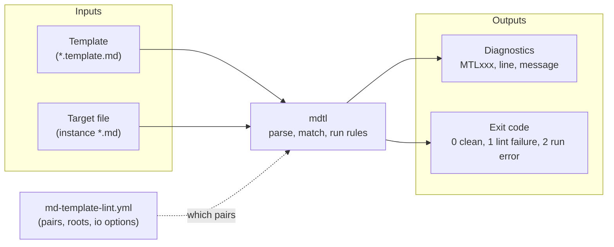

<div align="center">

# Markdown Template Linter

Lint your documents markdown like any other file.
<br>

[](https://github.com/m21-cerutti/md-template-lint/releases/latest/)
[](https://github.com/m21-cerutti/md-template-lint/releases)
[](https://github.com/m21-cerutti/md-template-lint/releases)
[](https://github.com/m21-cerutti/md-template-lint/tree/main)


<br>

</div>

<!-- prettier-ignore-start -->
<!-- omit in toc -->
## Summary
<!-- prettier-ignore-end -->

- [Description](#description)
- [Installation](#installation)
- [Usage](#usage)
  - [Quick example](#quick-example)
  - [Run modes](#run-modes)
  - [lint-staged](#lint-staged)
- [Configuration](#configuration)
- [Template syntax](#template-syntax)
- [Security](#security)
- [This repository lints its own docs](#this-repository-lints-its-own-docs)
- [Documentation](#documentation)
- [Development](#development)
- [License](#license)
- [AI-Assisted Development](#ai-assisted-development)

## Description

**Markdown Template Linter** (`mdtl`) checks Markdown files (frontmatter and headings) against Markdown templates. A template is a Markdown file and it is the schema: the frontmatter keys, their inline `#` comments and the heading suffixes (H1 to H6) carry the rules. There is no separate schema file. A project lists its template and target pairs in one `md-template-lint.yml`.



Every finding has a stable code `MTLnnn`: see the [error codes](docs/syntax-reference.md#error-codes).

## Installation

Node >= 22.18 is required. The package installs two commands that run the same program: `mdtl` and `md-template-lint`.

```bash
npm install -g md-template-lint
mdtl --version
```

Update to the latest version:

```bash
npm install -g md-template-lint@latest
```

With pnpm, or as a development dependency of one project:

```bash
pnpm add -g md-template-lint@latest
pnpm add -D md-template-lint
pnpm exec mdtl --version
```

## Usage

### Quick example

A minimal `md-template-lint.yml` at the project root:

```yaml
pairs:
  - template: templates/note.template.md
    include: docs/*.md
    description: project notes
```

The template `templates/note.template.md`. A field or a heading without a presence tag is required:

<!-- prettier-ignore -->
```yaml
---
title: Note title # [presence:required]
status: draft | done # [presence:required]
date: 2026-11-11 # [format:date]
---

# Note [pattern:"{text}"]

## Summary [content:non-empty]

## Details [content:non-empty]
```

The target `docs/note.md`:

<!-- prettier-ignore -->
```yaml
---
title: Release plan
status: wip
date: 2026-11-11
owner: alice
---

# Release plan

## Summary

Ship the first version.

## Details
```

Run `mdtl` in the project root:

```text
mdtl 0.2.0
Config: md-template-lint.yml
========================

Template: templates/note.template.md
Target:   docs/*.md (1 file(s)) - project notes

  ✗ docs/note.md
      error MTL517 Field 'status' (type=enum): value 'wip' is not one of the allowed options ['draft', 'done']
        3 | status: wip
      error MTL701 Section 'Details': [content:non-empty] section body is empty
        14 | ## Details
      warn  MTL202 Unknown key 'owner' not present in template
        5 | owner: alice

========================
Summary
========================
Total files:  1
Passed:       0
Failed:       1
Warnings:     1 (in 1 file(s))
Templates:    1 checked, 0 broken

Failed files:
  - docs/note.md

========================
```

The exit code is `1`. The list of codes and their fixes is in the [syntax reference](docs/syntax-reference.md#error-codes).

### Run modes

```bash
mdtl                           # full run: every pair of md-template-lint.yml
mdtl docs/note.md              # only these files (lint-staged mode)
mdtl --verify                  # check the syntax of every template, lint no target
mdtl --verify templates/note.template.md   # check this template, needs no config
mdtl --config tools/md-template-lint.yml   # another config file
mdtl --format json             # one JSON document on stdout
mdtl --quiet                   # print only failures
```

- **Full run** (no file argument): load the config and run every pair.
- **File arguments:** a file is a target when it matches the `include` globs of a pair and no `exclude`. A file that matches no pair is skipped silently. A file that matches a pair but does not exist is `MTL912`.
- **`--verify`:** parse the templates and print their schema and their problems. No target is read and the network is not used.
- **`--format`:** `text` (default), `plain` (the words `PASS`, `FAIL`, no color) or `json`.
- **Exit codes:** `0` clean (warnings never fail), `1` a target has an error or a template is broken, `2` a run error (usage, config, missing file).

Backslash and slash are both accepted in every path argument and in `--config`, on every OS. Printed paths always use `/`. On Windows, absolute paths on any drive work too:

```powershell
mdtl D:\notes\adr\0003-third.md
mdtl "E:/work/project/docs/adr/0004-fourth.md"
```

All flags, the output layout, the JSON keys and the path rules are in [docs/cli.md](docs/cli.md).

### lint-staged

The CLI accepts the file list that [lint-staged](https://github.com/lint-staged/lint-staged) appends. A staged file that matches no pair is skipped, so the glob can be `*.md`. In `.lintstagedrc.json`:

```json
{
  "*.md": "mdtl --quiet"
}
```

`--quiet` prints nothing when clean. Exit 1 or 2 makes lint-staged abort the commit.

## Configuration

One `md-template-lint.yml` per project, found in the working directory or in a parent folder (or given with `--config`). It is YAML and it is validated strictly: an unknown key is an error and all config errors are reported together before any linting (exit 2).

| Key                    | Default | Meaning                                                                                  |
| ---------------------- | ------- | ---------------------------------------------------------------------------------------- |
| `pairs`                | none    | Required list. Each pair has a `template`, `include` globs and optional `exclude` globs. |
| `onEmpty`              | `warn`  | What to do when a pair matches no file: `warn`, `error` or `ignore`.                     |
| `roots`                | empty   | Extra named folders where pairs can run (multi-root, external roots).                    |
| `aliases`              | empty   | Names for `@name/...` path values checked by `[io:exists]`.                              |
| `approvedPaths`        | empty   | Folders where absolute path values may be probed by `[io:exists]`.                       |
| `allowPrivateNetworks` | `false` | Lets `[io:exists]` URL probes reach private network ranges.                              |

Every key, the pair options, the path rules and the globs are in [docs/configuration.md](docs/configuration.md).

## Template syntax

A template starts with a YAML frontmatter block. Each top-level key is a field. A trailing `#` comment on the key line holds bracket tags (`[family:argument]`). The headings of the body, at every level (H1 to H6), can carry bracket tags after their text. A field or a heading without a presence tag is required. Tag names are case-insensitive, and tags in a target file are inert.

The rules are grouped by category, each with its own range of codes:

| Category | Codes                | Tags and what they check                                                                                                                                      |
| -------- | -------------------- | ------------------------------------------------------------------------------------------------------------------------------------------------------------- |
| syntax   | `MTL001` to `MTL099` | Parsing, template tag problems and disable directive problems. No tag of its own.                                                                             |
| filename | `MTL1xx`             | `# [filename:case:<convention>]` on a standalone comment line, `[value:filename]`: the file name and a value that must equal it.                              |
| presence | `MTL2xx`             | `[presence:required]`, `[presence:optional]`, `[presence:conditional:<text>]`, and `[presence:template-only]` on a heading.                                   |
| format   | `MTL3xx`             | `[format:constant:<value>]`, `[format:snake_case]`, `[format:kebab-case]`, `[format:semver]`, `[format:date]`, `[format:scheme:<list>]`, `elements:` forms.   |
| bounds   | `MTL4xx`             | `[count:min:N]`, `[count:max:N]`, `[range:min:N]`, `[range:max:N]`, `[order:ascending]`.                                                                      |
| type     | `MTL5xx`             | Type hints choose the field type: `[date]`, `[list-of-int]`, `url`, `path`, `@name/`, an option list `a \| b`. Without a hint the type is inferred.           |
| heading  | `MTL6xx`             | `[pattern:"..."]`, `[repeat-rules:same-level]`, `[order:...]`, `[content:subheadings:disallow]`, `[content:subheadings:no-extra]`, `[unique-headings-names]`. |
| content  | `MTL7xx`             | `[content:non-empty]`, `[content:table]`, `[content:list]`, `[content:min-lines:N]`, `[content:max-lines:N]` on the section body of a heading.                |
| io       | `MTL8xx`             | `[io:exists]` checks that a path or a URL exists. Opt-in, warnings only. See [Security](#security).                                                           |
| run      | `MTL9xx`             | Not rules: problems of the run itself (config, command line, missing files).                                                                                  |

Headings are matched by position, with exact text and exact level. A heading pattern such as `## Release [pattern:"[{semver}] - {date}"]` matches any heading of that shape, and `[repeat-rules:same-level]` lets it repeat.

A target file silences codes locally with a comment such as `<!-- md-template-lint disable-line MTL202 -->`. There is no wildcard, no config key that disables a rule, and the run codes cannot be disabled.

The full reference, with every tag form, the heading patterns, the type hints, the disable directives and the error codes:

- [docs/syntax-reference.md](docs/syntax-reference.md), with [tag forms](docs/syntax-reference.md#tag-forms), [heading patterns](docs/syntax-reference.md#heading-patterns), [type hints](docs/syntax-reference.md#type-hints) and [disable directives](docs/syntax-reference.md#disable-directives-target-files-only)
- [docs/spec.md](docs/spec.md), the contract that wins over every other document
- [docs/grammar.md](docs/grammar.md), how headings are read

## Security

Only one tag touches the file system or the network: `[io:exists]`. It is opt-in, written in the template, checked on target files only, and every finding is a warning (`MTL801` to `MTL805`) that never changes the exit code. `--verify` never uses the network. The config file is trusted input; the documents it lints are not.

Paths (`path`, `list-of-path`, `@name/...` values):

- An absolute path is never probed unless it lies inside one of the `approvedPaths` of the config. The default list is empty, so an absolute path is skipped with `MTL803`.
- An `@name/...` value is checked only when `name` is declared under `aliases`. An undeclared alias is skipped with `MTL801`; aliases are never guessed.
- A relative path is resolved against the root of the pair. A `..` segment is not contained, so `approvedPaths` restricts absolute values only; the result is a warning telling whether a file exists.

URLs (`url`, `list-of-url`):

- Only `http` and `https` are probed. Any other scheme is refused before any network call.
- One `HEAD` request, then one `GET` if it fails. No cookies, no credentials, no authorization header; the user info of the URL is stripped. The body is never read.
- Redirects are off: a redirect is never followed, and a 3xx status counts as reachable.
- Timeout: 5 seconds per request and 10 seconds per URL.
- A URL is probed once per run, and at most 100 different URLs are probed per run (`url budget exceeded` after that).
- Private networks are off: loopback, `localhost`, link-local, cloud metadata, multicast and reserved addresses, and numeric host spellings are always refused. RFC 1918, 100.64.0.0/10 and fc00::/7 are refused too, unless `allowPrivateNetworks: true` is set in the config (default `false`). The resolved address is checked again when the connection opens, against DNS rebinding.
- The reason shown in `MTL805` comes from a fixed list (`HTTP <status>`, `timeout`, `DNS failure`, `connection refused`, `blocked address`, ...) and is cut at 60 characters. Remote text is never echoed.

On Windows, a UNC path (`\\server\share`) in any config path value makes the operating system contact that server, so use one only for a server you trust. Details: [docs/configuration.md](docs/configuration.md#io-options-approvedpaths-aliases-allowprivatenetworks) and [docs/spec.md](docs/spec.md) section 2.8. To report a vulnerability, see [CONTRIBUTING.md](CONTRIBUTING.md#security-reports).

## This repository lints its own docs

This repository checks its own Markdown against the templates in [`templates/`](templates/) (this repository's variants) and [`templates/generic/`](templates/generic/) (the reusable ones, copy and adapt). The root [`md-template-lint.yml`](md-template-lint.yml) lists the pairs (the ADRs, `docs/architecture.md` and `AGENTS.md`). The pre-commit hook runs lint-staged ([`.lintstagedrc.json`](.lintstagedrc.json)), which lints the staged Markdown files with the built CLI.

To check all pairs by hand from a clone, build first. The `mdtl` command is not on the PATH in a clone, so `node dist/cli.js` stands for `mdtl` there:

```bash
pnpm install --frozen-lockfile
pnpm run build
node dist/cli.js
```

## Documentation

- [docs/README.md](docs/README.md): index of everything under `docs/`.
- [docs/cli.md](docs/cli.md): flags, exit codes, output formats, `--verify`, paths.
- [docs/configuration.md](docs/configuration.md): the `md-template-lint.yml` file.
- [docs/syntax-reference.md](docs/syntax-reference.md): how to write a template, and the error codes.
- [docs/spec.md](docs/spec.md): the contract (tags, types, codes, config, CLI, output).
- [docs/architecture.md](docs/architecture.md): modules, run flow, rule contract.
- [docs/grammar.md](docs/grammar.md) and [docs/glossary.md](docs/glossary.md): how headings are read, and the terms of the project.
- Guides: [adding a rule](docs/guides/adding-a-rule.md), [adding a tag](docs/guides/adding-a-tag.md), [grammar and listeners](docs/guides/grammar-and-listeners.md), [testing](docs/guides/testing.md).
- [docs/adr/](docs/adr/0001-genesis.md): architecture decision records. [ADR 0014](docs/adr/0014-legacy-behaviour-catalogue.md) lists the changes from the legacy tools.
- [CHANGELOG.md](CHANGELOG.md), [CONTRIBUTING.md](CONTRIBUTING.md), [THIRD_PARTY_NOTICES.md](THIRD_PARTY_NOTICES.md).

## Development

Setup, quality gates, tests, the parser generation and the commit style are in [CONTRIBUTING.md](CONTRIBUTING.md). In short:

```bash
pnpm install --frozen-lockfile
pnpm run build
pnpm test
```

## License

MIT, Copyright (c) 2026 Marc CERUTTI. See [LICENSE](LICENSE).

## AI-Assisted Development

See [AI_GUIDELINE.md](AI_GUIDELINE.md).
