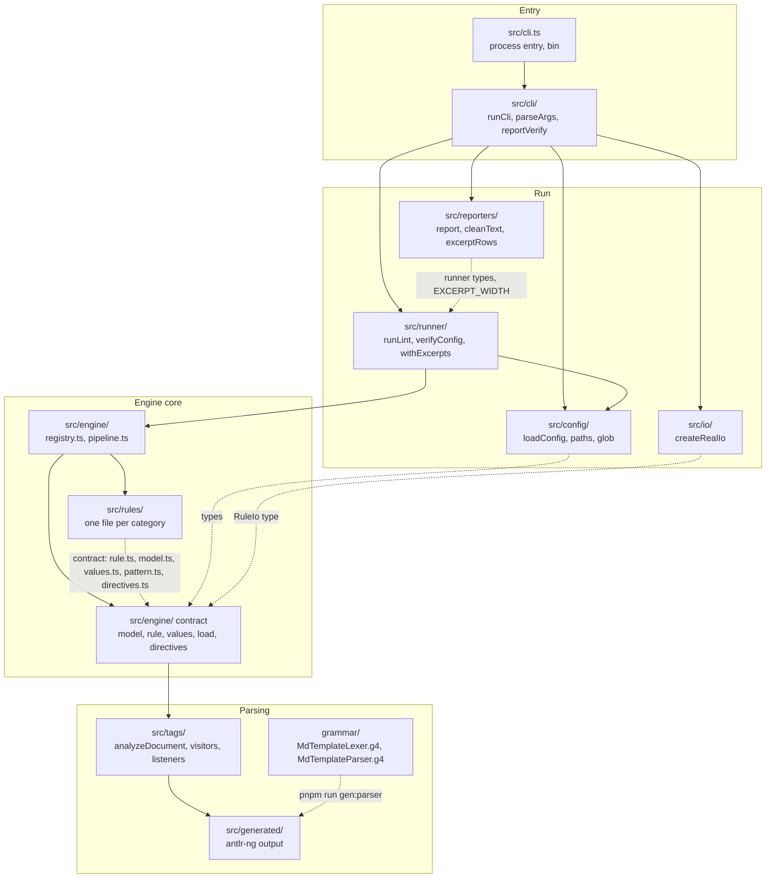
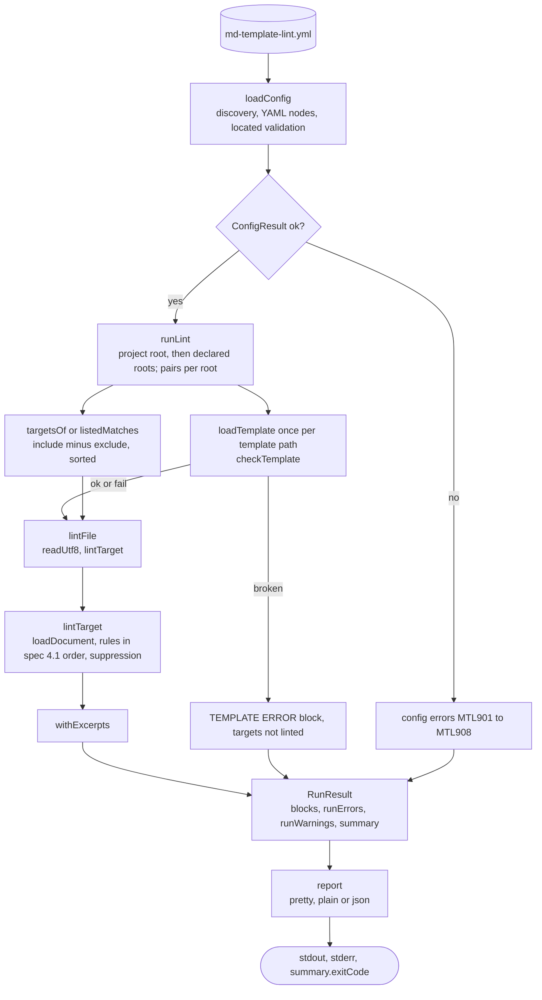
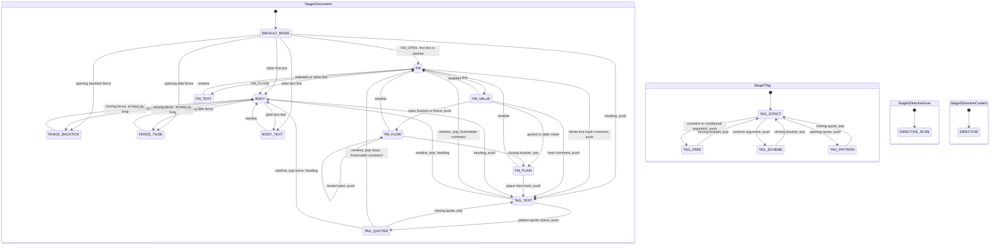
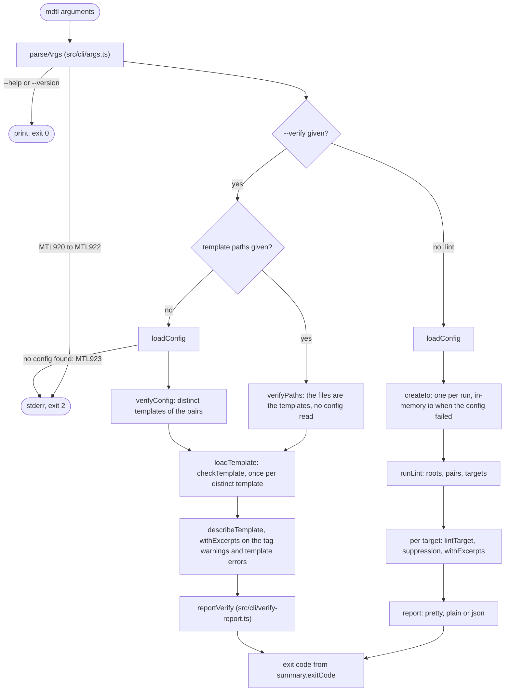

# Architecture

`md-template-lint` (command `mdtl`) checks Markdown files against Markdown templates: a config pairs
each template with globs, a grammar reads the bracket tags of the template, and rules compare each
target with its template. This page shows how the code is split into layers and how data moves
through them. The contract is [spec.md](spec.md); the user-facing references are the
[syntax reference](syntax-reference.md), the [command line](cli.md), the
[configuration](configuration.md) and the [grammar](grammar.md). When this page and the spec
disagree, the spec wins.

Guides for changes (this page holds no step lists): [Adding a rule](guides/adding-a-rule.md),
[Adding a tag](guides/adding-a-tag.md), [Grammar and listeners](guides/grammar-and-listeners.md),
[Testing](guides/testing.md). Terms: [glossary](glossary.md).

<!-- prettier-ignore-start -->
<!-- omit in toc -->
## Summary
<!-- prettier-ignore-end -->

- [Overview](#overview)
  - [Data flow](#data-flow)
  - [Run flow: config, runner, pipeline, reporters](#run-flow-config-runner-pipeline-reporters)
  - [Engine](#engine)
  - [CLI](#cli)
  - [Rules and contracts](#rules-and-contracts)
  - [Reporters](#reporters)
  - [Runner and config](#runner-and-config)
  - [io](#io)
- [Legend](#legend)
- [Layering rules](#layering-rules)
- [Decisions](#decisions)
- [Known limits](#known-limits)
- [Discrepancies](#discrepancies)

## Overview

The code is a stack of layers, from the grammar at the bottom to the process entry at the top. A
run reads the config, walks the targets of each pair, parses the template and each target, runs the
rules of `src/rules/<category>.ts` in a fixed order and prints the diagnostics (`MTLnnn` codes) as
text, plain text or JSON.



- **Entry**: `src/cli.ts` reads the process; `src/cli/` turns arguments into a lint or a `--verify` run.
- **Run**: `src/config/` loads `md-template-lint.yml`, `src/runner/` walks roots, pairs and targets,
  `src/io/` is the production file and URL access given to rules, `src/reporters/` formats the result.
- **Engine core**: `src/engine/` loads documents and holds the rule contract; `registry.ts` and
  `pipeline.ts` run the rules of `src/rules/` in order.
- **Parsing**: `src/tags/` turns text into a typed AST with the parser that antlr-ng generates from
  `grammar/` into `src/generated/`. Only this layer knows ANTLR.

`src/index.ts` re-exports the package API of every layer. Arrow meanings: see the [Legend](#legend).

Sources: `src/cli.ts`, `src/cli/run.ts`, `src/config/load.ts`, `src/runner/run.ts`, `src/io/index.ts`,
`src/reporters/index.ts`, `src/engine/pipeline.ts`, `src/engine/registry.ts`, `src/tags/parser.ts`,
`src/index.ts`

| Path                                          | Role                                                                                                                                                                                                                                                                                                                                                     |
| --------------------------------------------- | -------------------------------------------------------------------------------------------------------------------------------------------------------------------------------------------------------------------------------------------------------------------------------------------------------------------------------------------------------- |
| `grammar/MdTemplateLexer.g4`                  | Lexer with region modes. With the parser grammar, the only home of the tag syntax.                                                                                                                                                                                                                                                                       |
| `grammar/MdTemplateParser.g4`                 | Parser: `document`, `fm*` (frontmatter), `body*` (body), `tag*` and `directive*` rule families.                                                                                                                                                                                                                                                          |
| `src/generated/`                              | antlr-ng output. Never hand-edited (`pnpm run gen:parser`, `pnpm run check:parser`).                                                                                                                                                                                                                                                                     |
| `src/tags/`                                   | `parser.ts` (two-stage parse, `analyzeDocument`), `listeners.ts`, `visitors/`, `ast.ts`, `types.ts`.                                                                                                                                                                                                                                                     |
| `src/engine/load.ts`, `infer.ts`, `values.ts` | `loadDocument` / `loadFile`, type inference (spec 3.2), loose value predicates (spec 3.3).                                                                                                                                                                                                                                                               |
| `src/engine/model.ts`, `pattern.ts`           | `DocumentModel`, `Field`, `Section`, `Diagnostic`, heading matching; heading patterns and order keys.                                                                                                                                                                                                                                                    |
| `src/engine/rule.ts`, `ranges.json`           | Rule contract (categories, phases, steps, contexts, `RuleEnv`, `defineRule`, report helpers); code ranges.                                                                                                                                                                                                                                               |
| `src/engine/registry.ts`                      | Loads the nine rule files (`RULE_FILES`), validates codes, categories and steps.                                                                                                                                                                                                                                                                         |
| `src/engine/directives.ts`                    | Disable directives of a target (spec 4.4): validation, suppression plan, coverage.                                                                                                                                                                                                                                                                       |
| `src/engine/pipeline.ts`                      | `checkTemplate`, `lintTarget` / `checkTarget`: load, rules in spec 4.1 order, suppression.                                                                                                                                                                                                                                                               |
| `src/rules/<category>.ts`                     | One file per category (spec 9). Each exports `rules: readonly AnyRule[]`.                                                                                                                                                                                                                                                                                |
| `src/config/`                                 | `loadConfig` (`load.ts`), path resolver (`paths.ts`), globs (`glob.ts`), types (`types.ts`).                                                                                                                                                                                                                                                             |
| `src/runner/`                                 | `runLint` (`run.ts`), walk, file list, `--verify`, template load, schema, excerpts, strict UTF-8 reads.                                                                                                                                                                                                                                                  |
| `src/reporters/`                              | `report`: `pretty`, `plain`, `json`; `cleanText`; excerpt rows.                                                                                                                                                                                                                                                                                          |
| `src/io/`                                     | `createRealIo`: production `RuleIo` (`exists`, guarded `probeUrl`).                                                                                                                                                                                                                                                                                      |
| `src/cli.ts`, `src/cli/`                      | Process entry, `execute` catch-all, `parseArgs`, `runCli`, `--verify` reporter, version.                                                                                                                                                                                                                                                                 |
| `scripts/`                                    | TypeScript scripts run by `tsx` ([ADR 0007](adr/0007-tsx-script-runner.md)): `gen-parser.ts`, `check-parser.ts`, `new-rule.ts` (rule scaffold), `smoke-pack.ts` and `smoke/` (`check-release.ts`, run by the release workflow), `syntax-doc/`. `write-escaped.ts` (fixtures with control characters) is run directly by `node scripts/write-escaped.ts`. |

### Data flow

```mermaid
flowchart LR
  bytes["file bytes"] --> read["readUtf8 or loadFile<br/>strict UTF-8"]
  read --> analyze["analyzeDocument<br/>normalizeLineEnds, stage 1 and stage 2 parses"]
  analyze --> ast["MarkdownDocument<br/>typed AST, findings, directives"]
  ast --> load["loadDocument<br/>YAML values, comment binding, sections"]
  load -->|"no frontmatter, bad YAML, not a mapping"| failure["ParseFailure"]
  load -->|"parsed"| model["DocumentModel<br/>fields, sections, filename, findings, directives"]
  failure --> rules["rules of src/rules<br/>parse phase only"]
  model --> allRules["rules of src/rules<br/>template, field and target phases"]
  rules --> diag["Diagnostic<br/>code, severity, message, position"]
  allRules --> diag
  diag --> suppress["suppression by the target directives"]
  suppress --> excerpt["withExcerpts<br/>ReportedDiagnostic"]
  excerpt --> reporters["reporters"]
```



Text becomes a typed AST in `src/tags/` (`analyzeDocument`: line endings normalized, stage-1 parse of
the whole text, stage-2 parse of each tag bracket and each directive comment). `loadDocument` reads the
YAML values (`yaml`, failsafe schema), binds the inline comment of key line N to the key on line N
(spec 2.1), keeps the findings of YAML key lines, filename lines and the body, and builds one `Section`
per heading of any level with its parent. A document that cannot load is a `ParseFailure`, which only
the `parse` rules (`MTL001` to `MTL004`) see. Rules return `Diagnostic` values; the pipeline drops the
ones the target directives cover, and the runner adds a bounded source excerpt before the reporters
print them.

Sources: `src/runner/files.ts`, `src/tags/parser.ts`, `src/engine/load.ts`, `src/engine/model.ts`,
`src/engine/pipeline.ts`, `src/engine/directives.ts`, `src/runner/excerpt.ts`

### Run flow: config, runner, pipeline, reporters



`loadConfig` finds the config (`--config`, else the working directory and each parent), walks the YAML
nodes so every error has a file, line, column and key path, resolves every path with one resolver and
compiles the globs. `runLint` goes root by root (the project first, then `roots` in declaration order),
then pair by pair in config order. Per pair it checks the template once (`MTL910`, `MTL911`), finds the
targets (`MTL913` when none, per `onEmpty`) and parses the template once per resolved path
(`parseOnce`). A broken template blocks its targets; a template with a template error (`MTL017`,
`MTL018`, `MTL019`, `MTL030`) fails but its targets are still linted. Each target is read as strict UTF-8
and linted with `env = { aliases, approvedPaths, pairRoot, io }`. The exit code (spec 7.5) is
`summary.exitCode`: 2 with any run error, else 1 with a failed file, broken or failed template, else 0.
Warnings and suppressed diagnostics never change it.

Sources: `src/config/load.ts`, `src/runner/run.ts`, `src/runner/walk.ts`, `src/runner/list.ts`,
`src/runner/template.ts`, `src/engine/pipeline.ts`, `src/runner/excerpt.ts`, `src/reporters/index.ts`

### Engine

The engine turns text into models and runs the rules. It has three parts: the grammar and its
generated parser, `src/tags/` (parse to typed AST), and `src/engine/` (load, rule contract, registry,
pipeline). The grammar reference for users is [grammar.md](grammar.md); the working guide is
[Grammar and listeners](guides/grammar-and-listeners.md).

#### Lexer modes

`grammar/MdTemplateLexer.g4` has one lexer and 18 modes (`DEFAULT_MODE` plus 17 `mode` blocks). The
modes are the regions of a document. Stage 1 starts in `DEFAULT_MODE` over the whole text. Stage 2
starts a new lexer in one mode over a small piece of text, through `createRecognizers(text, mode, push,
map)` in `src/tags/listeners.ts`: `TAG_STRICT` over one bracket, `DIRECTIVE_SCAN` over the whole text,
`DIRECTIVE` over one comment content. No stage-1 rule leads into those modes, so stage-1 tokens never
change when a tag or a directive is added.



The diagram groups the modes by the parse stage that starts a lexer in them and shows the `mode(...)`,
`pushMode(...)` and `popMode` actions of the lexer file. `parseInlineComment` and `parseHeadingSuffix`
start in `TAG_TEXT` (pushed), `parseFilenameComment` in `FM`.

Sources: `grammar/MdTemplateLexer.g4`, `src/tags/listeners.ts`, `src/tags/parser.ts`

| Mode                                               | Holds                                                                                              |
| -------------------------------------------------- | -------------------------------------------------------------------------------------------------- |
| `DEFAULT_MODE`                                     | Start of the document: `---` opens the frontmatter, any other first line is a body line.           |
| `FM`, `FM_VALUE`, `FM_PLAIN`, `FM_FLOW`, `FM_TEXT` | Frontmatter: key lines, the value start, the rest of a value, flow collections, other lines.       |
| `BODY`, `BODY_TEXT`                                | Body line starts (heading, table row, list item, one-line HTML comment, blank) and plain lines.    |
| `FENCE_BACKTICK`, `FENCE_TILDE`                    | Inside a code fence: no heading, no tag. The closing fence is at least as long as the opening one. |
| `TAG_TEXT`, `TAG_QUOTED`                           | Text of an inline comment or a heading (stage 1), and the quoted argument of `[pattern:"`.         |
| `TAG_STRICT`                                       | One bracket of a known family re-lexed strictly (stage 2): tag keywords live here only.            |
| `TAG_FREE`, `TAG_SCHEME`, `TAG_PATTERN`            | Free text argument (`constant:`, `conditional:`), scheme list (`scheme:`), heading pattern text.   |
| `DIRECTIVE_SCAN`                                   | One target re-lexed: comment markers, backtick runs, text (spec 4.4). `scanComments` pairs them.   |
| `DIRECTIVE`                                        | The content of one comment: the keyword, the verbs, codes, the `--` reason.                        |

A `DS_*` rule of `DEFAULT_MODE` mirrors a `B_*` rule of `BODY`; `pnpm run check:rules` checks that
mirror ([consistency check](#consistency-check)).

#### Listeners and error flow

| Listener or visitor   | Runs on                                       | Reports to                             |
| --------------------- | --------------------------------------------- | -------------------------------------- |
| `LexerErrorListener`  | every lexer (stage 1, stage 2, entry helpers) | the `SyntaxEventLog` of that parse     |
| `ParserErrorListener` | every parser (same)                           | the `SyntaxEventLog` of that parse     |
| family visitors       | stage-2 parse tree of one bracket             | tag data, located by `parser.ts`       |
| `TypeHintListener`    | stage-1 tree of an inline comment             | hints, located by the session map      |
| `DirectiveVisitor`    | `directiveEntry` tree of one comment content  | directive data, located by `parser.ts` |
| `DiagnosticCollector` | one whole document parse                      | `DocumentAnalysis`                     |

- Both error listeners map the ANTLR line and column through a `PositionMap`; for a stage-2 bracket the
  map adds the bracket offset, so every location is a file position.
- Stage-1 events are grammar bugs: the collector stores them as `GrammarError`, `analyzeDocument`
  returns them with `document: null`, and `parseDocument` and `loadDocument` throw
  `InternalParseError`. They are never user diagnostics, and the runner lets them propagate.
- Stage-2 events are user input. The first event of `fmTagEntry` / `bodyTagEntry` becomes a
  `malformed` finding, or `wrong-region` when the other region accepts the bracket. `directiveScanEntry`
  and `directiveEntry` accept any input, so their events are grammar bugs like stage 1.
- Findings (`unknown`, `malformed`, `wrong-region`) reach `DocumentModel.findings`; the `template` rules
  of `src/rules/syntax.ts` turn them into `MTL010` to `MTL013`. `MTL014`, `MTL015` and the template
  errors `MTL017`, `MTL018`, `MTL019`, `MTL030` are read from the template headings, `MTL016` from the
  template fields.

#### Pipeline

`checkTemplate(registry, text)` loads a template and runs the `parse` or `template` rules; it returns
the tag warnings (`MTL010` to `MTL016`) and, apart, the template errors, each sorted by source position.
`lintTarget(registry, template, text, targetPath, env)` loads the target, runs the rules in the order
below and returns `{ diagnostics, suppressed }`; `checkTarget` is the same without the count. Both are
async and await each check before the next, so io timing never changes the order. The registry
(`createRegistry`) loads `RULE_FILES` and throws `RegistryError` on a duplicate code, a category that
does not match its file, a code outside the range, or a missing, unknown or unexpected `step`.

#### Emission order (spec 4.1, 8.4)

1. A parse failure runs only the `parse` rules.
2. `target` rules of step `filename`.
3. For each template field in template order: when the target value is missing or empty, only the
   `field` rules of step `presence`; otherwise the steps `constant`, `count`, `range`, `order`, `scheme`,
   `io`, `value-filename`, `case`, `elements`, `type`, `shape` (`FIELD_STEPS`).
4. `target` rules of steps `unknown-keys`, `headings`, `content`, then `directives` (`TARGET_STEPS`).
5. Suppression: the target directives give a plan (`analyzeDirectives`), and every diagnostic it covers
   (`isCovered`: code and anchor line) is removed and counted. `MTL020` to `MTL025` are never removed.

Inside one step the order is the registry order; the result lists errors first, then warnings. Four
steps re-sort their findings with side tables (`WeakMap`), never fields on the `Diagnostic`:

| Step         | Order                                                     | Recorded by             | Sorted by                    |
| ------------ | --------------------------------------------------------- | ----------------------- | ---------------------------- |
| `headings`   | template heading line; unanchored `MTL604`, `MTL613` last | the diagnostic position | stable sort in `pipeline.ts` |
| `io`         | item order inside one field                               | `reportItem`            | `byItemIndex`                |
| `content`    | template section order                                    | `reportSection`         | `bySectionIndex`             |
| `directives` | directive source order, item order, `MTL024` last         | `reportSequenced`       | `bySequence`                 |

The `headings` step clears the template-line anchor after the sort and sets `Diagnostic.heading` (spec
8.1) for the heading and content findings.

#### Anchor lines (spec 4.4 DIR5)

`anchorLineOf(diagnostic)` (`src/engine/rule.ts`) gives the 1-based target line a diagnostic is about,
or null. It is a side table, not a field. The suppression coverage reads it, and so does the runner
(`withExcerpts`) to quote that line. Field-step findings are anchored on the target key line by the
pipeline (`setAnchorLine`); heading, content and directive rules record their own line (`reportOnLine`,
`reportSection`, `reportSequenced`). `MTL101`, `MTL601`, `MTL604`, `MTL605`, parse failures and template
diagnostics have no anchor. The full table is in [spec.md 4.4](spec.md#44-disable-directives-in-target-files).

Sources: `src/engine/pipeline.ts`, `src/engine/registry.ts`, `src/engine/rule.ts`,
`src/engine/directives.ts`, `src/tags/listeners.ts`, `src/tags/parser.ts`

### CLI



`src/cli.ts` (built to `dist/cli.js`, the package `bin` `mdtl` with the alias `md-template-lint`) only
reads the process: arguments, working directory, `stdout.isTTY`, `NO_COLOR`. It writes what `execute`
returns and sets `process.exitCode`. `execute` (`src/cli/main.ts`) wraps `runCli` in a catch-all: an
unexpected exception is exit 2 with `error: unexpected failure (<code or name>)`, never the message,
which can carry an absolute path. `runCli(argv, env)` (`src/cli/run.ts`) holds all behaviour: `argv` and
`env = { cwd, home?, boundary?, isTty, noColor, version?, createIo? }` in, `{ stdout, stderr, exitCode }`
out, so tests call it without a process. `--format text` maps to the `pretty` reporter; color only for
`text` on a terminal with `NO_COLOR` unset or empty.

- Lint mode: one io per run (`createIo`, default `createRealIo`), since it holds the URL cache and
  budget. Positional arguments switch to file-list mode (`resolveFileList`, `listedMatches` in
  `src/runner/list.ts`): a path test against each pair's globs, no directory walk, unmatched files
  listed in `RunResult.unmatched`. On Windows the directories down to the root compare without case
  (`ignoreRootCase`), so a differently cased working directory does not skip every file.
- `--verify`: `src/runner/verify.ts` loads each distinct template once with `loadTemplate` (the same as
  lint), builds no io and reads no target. `describeTemplate` (`src/runner/schema.ts`) builds the schema
  (filename convention, fields, headings) from the `DocumentModel`; there is no second parser.

Flags, exit codes and output layouts: [cli.md](cli.md) and [spec.md 7](spec.md#7-cli).

Sources: `src/cli.ts`, `src/cli/main.ts`, `src/cli/run.ts`, `src/cli/args.ts`, `src/cli/verify-report.ts`,
`src/runner/verify.ts`, `src/runner/schema.ts`, `src/runner/list.ts`

### Rules and contracts

#### Rule contract

```ts
defineRule({
  code: "MTL301", // MTL + 3 digits, inside the category range (src/engine/ranges.json)
  name: "constant-mismatch", // the spec 4.3 name
  severity: "error", // default; a check may override per diagnostic
  category: "format", // must match the file
  phase: "field", // "parse" | "template" | "field" | "target"
  step: "constant", // field and target phases only
  check: (context) => [], // Diagnostic[] or Promise<Diagnostic[]>
});
```

| Phase      | Context                                                                                    | Step         |
| ---------- | ------------------------------------------------------------------------------------------ | ------------ |
| `parse`    | `ParseContext`: role (template or target), `ParseFailure`                                  | none         |
| `template` | `TemplateContext`: the template model with its tag findings                                | none         |
| `field`    | `FieldContext`: key, template field, target value or null, both models, target path, `env` | `FieldStep`  |
| `target`   | `TargetContext`: both models, target path, `env`, `knownCodes` (spec 4.3 codes)            | `TargetStep` |

`RuleEnv` carries the config `aliases`, `approvedPaths`, the `pairRoot` and the `io` (`RuleIo`:
`exists(path)`, `probeUrl(url, timeoutMs)`, never throws). A rule never touches the file system or the
network itself. `createMemoryIo` and `createEnv` build an in-memory env for tests.

#### Where the codes live

Each category is one file in `src/rules/` with a fixed code range (`src/engine/ranges.json`, spec 4.2).
Every code, name and message is in the [spec 4.3 code table](spec.md#43-code-table) and the
[syntax reference](syntax-reference.md).

| Codes             | Category (file)            | Phase and steps                                                            |
| ----------------- | -------------------------- | -------------------------------------------------------------------------- |
| `MTL001`-`MTL099` | `syntax` (`syntax.ts`)     | `parse`, `template` (tag warnings, template errors), `target` `directives` |
| `MTL100`-`MTL199` | `filename` (`filename.ts`) | `target` `filename`; `field` `value-filename`                              |
| `MTL200`-`MTL299` | `presence` (`presence.ts`) | `field` `presence`; `target` `unknown-keys`                                |
| `MTL300`-`MTL399` | `format` (`format.ts`)     | `field` `constant`, `case`, `elements`, `scheme`, `shape`                  |
| `MTL400`-`MTL499` | `bounds` (`bounds.ts`)     | `field` `count`, `range`, `order`                                          |
| `MTL500`-`MTL599` | `type` (`type.ts`)         | `field` `type`                                                             |
| `MTL600`-`MTL699` | `heading` (`heading.ts`)   | `target` `headings`                                                        |
| `MTL700`-`MTL799` | `content` (`content.ts`)   | `target` `content`                                                         |
| `MTL800`-`MTL899` | `io` (`io.ts`)             | `field` `io`                                                               |
| `MTL900`-`MTL999` | none: run diagnostics      | built by `src/config/`, `src/runner/`, `src/cli/` as `RunDiagnostic`       |

A code is never renumbered or reused. `MTL9xx` codes are not rules and have no registry entry
(`RUN_CODES` in `src/engine/directives.ts`).

#### Heading and section model

Every heading of any level (H1 to H6) is a `Section` (`src/engine/model.ts`) with `level`, `text`,
`line`, `tags`, `body`, `endLine` and `parent` (index of the nearest preceding lower-level heading).
`matchHeadings(template, target)` matches by position (spec 2.10, [ADR 0012](adr/0012-positional-heading-matching.md)):
the template headings of one level and scope are a sequence that takes the target siblings as one
adjacent run (`positionalRun`), with set-aside `[presence:template-only]` siblings, pattern and repeat
positions, and a tail of extra headings. Every rule of `src/rules/heading.ts` reads this one match, and
the content rules check the section of each match.

#### Consistency check

`pnpm run check:rules` (`tests/consistency/`) fails with one line per drift between the grammar, the
visitors, the AST kind lists, `KNOWN_TYPE_NAMES`, the `DS_*` / `B_*` lexer mirror, the rule files,
`src/engine/ranges.json`, the spec code table and the rule-case fixtures. The fixture layout it enforces
is in [Testing](guides/testing.md).

Sources: `src/engine/rule.ts`, `src/engine/ranges.json`, `src/engine/registry.ts`, `src/engine/model.ts`,
`src/engine/directives.ts`, `src/rules/heading.ts`, `tests/consistency/consistency.ts`

### Reporters

`report(result, { format, version, color?, quiet? })` (`src/reporters/index.ts`) takes a plain
`RunResult` and returns `{ stdout, stderr }`; it reads no file. `pretty` (`text.ts`) is the spec 8.2
layout with Unicode glyphs and ANSI color only when the caller passes `color: true`; `plain` is the same
layout with ASCII words and no color; `json` (`json.ts`) is spec 8.5. Run errors go to stderr.

- `cleanText` (`sanitize.ts`) is applied to every echoed string: line breaks and whitespace controls
  become one space; other controls, bidi controls, U+FEFF and invisible format characters are shown as
  escapes, so a document value cannot move the cursor or flip the text direction of a terminal or log.
- `excerptRows` (`excerpt.ts`) prints the gutter and caret rows of a `SourceExcerpt`; `cleanChar` keeps
  the caret under its character. `sourceLineOf` gives the JSON `sourceLine`.
- The `--verify` result has its own reporter, `reportVerify` (`src/cli/verify-report.ts`).

Sources: `src/reporters/index.ts`, `src/reporters/text.ts`, `src/reporters/json.ts`,
`src/reporters/sanitize.ts`, `src/reporters/excerpt.ts`, `src/cli/verify-report.ts`

### Runner and config

- `loadConfig` (`src/config/load.ts`) returns `ConfigResult`: `{ ok: true, config: LintConfig }` or
  every located error (`MTL901` to `MTL908`) sorted by position. `resolvePath` (`paths.ts`) is the one
  path resolver (`~`, drive letters, `/x`, relative, `\` read as `/`, `..` folded); `compileGlob`
  (`glob.ts`) gives a regex and the literal base directory where the walk starts. Globs are
  case-sensitive on every OS. Keys and defaults: [configuration.md](configuration.md).
- `runLint` (`src/runner/run.ts`) owns roots, pairs, the template cache, run diagnostics (`MTL909` to
  `MTL913`) and the summary. `targetsOf` (`walk.ts`) lists include minus exclude, sorted; symbolic links
  to files are targets, links to directories are not traversed. `readUtf8` (`files.ts`) is the strict
  read whose errors carry no absolute path.
- `withExcerpts` (`src/runner/excerpt.ts`) splits the file text once and gives each diagnostic a window
  of at most `EXCERPT_WIDTH` (100) characters, from its position line or its anchor line. Lint mode
  drops the template text after parsing (`withoutText`, `template.ts`).
- `RunResult` (`types.ts`) stays plain data: no side table crosses into the reporters.

Sources: `src/config/load.ts`, `src/config/paths.ts`, `src/config/glob.ts`, `src/config/types.ts`,
`src/runner/run.ts`, `src/runner/walk.ts`, `src/runner/files.ts`, `src/runner/excerpt.ts`,
`src/runner/template.ts`, `src/runner/types.ts`

### io

`createRealIo({ allowPrivateNetworks?, fetch?, resolve?, maxUrls?, hardCapMs? })` (`src/io/index.ts`)
returns the production `RuleIo` that `[io:exists]` rules call. `exists` swallows every OS error. `probeUrl`
is guarded against server-side request forgery (OWASP A10):

| Guard                                                                                                 | Where                                                                      |
| ----------------------------------------------------------------------------------------------------- | -------------------------------------------------------------------------- |
| Scheme allow-list `http`, `https`, before any I/O                                                     | `probe` in `src/io/index.ts`                                               |
| `redirect: "manual"`: a 3xx is reachable, never followed                                              | request init and the default transport                                     |
| Loopback, link-local, metadata, reserved, numeric IP spellings and `localhost` refused                | `hostProblem` (`src/io/index.ts`), `classifyAddress` (`src/io/address.ts`) |
| Private ranges only with `allowPrivateNetworks: true`                                                 | `isAddressAllowed` (`src/io/address.ts`)                                   |
| Resolved address checked again at connect time (DNS rebinding)                                        | `createGuardedLookup` in `src/io/transport.ts`                             |
| No credentials, no cookies, fixed User-Agent, no proxy; 5 s per request, 10 s hard cap, body not read | `probe`, `node:http(s)` with `agent: false`                                |
| Each URL probed once, at most `maxUrls` (100) URLs per run; reasons from a fixed vocabulary           | `probeUrl` cache, `reasonOf`                                               |

The default transport is `node:http` / `node:https` with a `lookup` hook, because the global `fetch`
cannot check the address the socket uses. Tests inject `fetch` and `resolve` and never use the network.

Sources: `src/io/index.ts`, `src/io/address.ts`, `src/io/transport.ts`

## Legend

Meaning of the arrows in the Overview flowchart. The other diagrams use the standard Mermaid meaning of
their own arrows (flowchart: control or data flow; state diagram: lexer mode change).

| Symbol       | Meaning                                                                                                                                                                                                                                                                                        |
| ------------ | ---------------------------------------------------------------------------------------------------------------------------------------------------------------------------------------------------------------------------------------------------------------------------------------------- |
| Solid arrow  | Call path of a run: the importer calls functions of the imported layer to do its work.                                                                                                                                                                                                         |
| Dotted arrow | Contract import: types, constants and helpers a layer builds on, not a step of the call path (`rules` import `defineRule`, `report` and the model helpers from `engine`; `reporters` import runner types and `EXCERPT_WIDTH`; `config` and `realio` import types only), or the generator step. |

Every arrow, solid or dotted, points down the layer order of the [Layering rules](#layering-rules).

## Layering rules

- A layer imports only from the layers below it: `grammar/` and `src/generated/`, then `src/tags/`, the
  `src/engine/` contract, `src/rules/`, `src/engine/registry.ts` and `pipeline.ts`, `src/config/` and
  `src/io/`, `src/runner/`, `src/reporters/`, then `src/cli/`. Review enforces it; no tool does.
- Only `src/tags/` and `src/generated/` import `antlr4ng`; tag syntax lives only in `grammar/*.g4`.
- Only `src/engine/registry.ts` imports the rule files (plus `enumOptions` in `src/runner/schema.ts`).
- A rule imports the engine contract and the AST types, never `config`, `runner`, `reporters`, `io` or
  `cli`; file and network access go through `context.env.io`.
- Reporters get plain data (`RunResult`, `VerifyResult`) and read no file.
- `src/cli.ts` is the only file that reads `process.argv`, `process.cwd()`, `process.env`, the
  terminal and writes the output and exit code; it passes that state to `runCli` as `env`. Other
  code still reads the machine directly (see
  [Discrepancies](#discrepancies)): `homedir()` when no `home` is given (`src/config/load.ts`,
  `src/runner/list.ts`, `src/runner/verify.ts`), `process.platform` for path case folding (`pathKey`
  in `src/runner/files.ts`, the `ignoreRootCase` default of `listedMatches` in `src/runner/list.ts`), and
  `package.json` when `env.version` is absent (`readVersion`, `src/cli/version.ts`).
- `src/index.ts` re-exports the API; nothing inside `src/` imports it.

## Decisions

- Split ANTLR grammar with region modes: [ADR 0002](adr/0002-grammar-structure.md).
- pnpm as package manager: [ADR 0003](adr/0003-pnpm.md).
- TypeScript-only scripts, run by `tsx` (`write-escaped.ts` by `node`): [ADR 0004](adr/0004-typescript-scripts.md), [ADR 0007](adr/0007-tsx-script-runner.md).
- Packaging and release: [ADR 0005](adr/0005-packaging-and-release.md).
- Licence of the generated parser: [ADR 0008](adr/0008-generated-parser-licence.md).
- All heading levels H1 to H6: [ADR 0009](adr/0009-all-heading-levels.md).
- Field formats: [ADR 0010](adr/0010-field-formats.md).
- Heading patterns: [ADR 0011](adr/0011-heading-patterns.md).
- Positional heading matching: [ADR 0012](adr/0012-positional-heading-matching.md).
- Unique heading names: [ADR 0013](adr/0013-unique-headings-names.md).

## Known limits

- The layering rules are checked by review only; an import across layers does not fail a gate.
- Config paths may be UNC (`\\server\share`). On Windows any access to them opens the share and sends
  the user's NTLM credentials to that server. The config is trusted (spec 2.8): configure UNC paths
  only for trusted servers and review an untrusted config before running it.
- A relative or alias value with `..` may leave the pair root. Its only use is `exists`, so it is an
  existence-only oracle; absolute values are gated by `approvedPaths`.
- File-list mode has no argument limit, but the shell has one: lint-staged splits long lists into
  several independent runs, each with its own summary.

## Discrepancies

The Overview flowchart draws the main edges only. These imports exist in `src/` and are not drawn:

| Area                        | Diagram says | Code does                                                                                                     | Action                              |
| --------------------------- | ------------ | ------------------------------------------------------------------------------------------------------------- | ----------------------------------- |
| `runner` to `rules`         | no edge      | `src/runner/schema.ts` imports the value `enumOptions`                                                        | Accepted: schema check shares enums |
| `runner` to `tags`          | no edge      | `src/runner/excerpt.ts` imports `normalizeLineEnds`; `schema.ts` imports AST types                            | Accepted                            |
| `runner` to `engine`        | no edge      | `src/runner/excerpt.ts` imports `anchorLineOf`; `schema.ts` imports `presenceMode` and `orderToken`           | Accepted                            |
| `cli` to `engine`           | no edge      | `src/cli/run.ts` imports the value `createMemoryIo`; `src/cli/verify-report.ts` imports the type `Diagnostic` | Accepted                            |
| `rules` to `tags`           | no edge      | `src/rules/*.ts` import AST types                                                                             | Accepted (type only)                |
| `reporters` to other layers | no edge      | `src/reporters/text.ts` imports types from `config` and `engine`; `json.ts` from `config`                     | Accepted (type only)                |

One rule of the [Layering rules](#layering-rules) is only partly true in the code:

| Area          | Intent                              | Code does                                                                                                                                                                          | Action                                                                                           |
| ------------- | ----------------------------------- | ---------------------------------------------------------------------------------------------------------------------------------------------------------------------------------- | ------------------------------------------------------------------------------------------------ |
| process state | only `src/cli.ts` reads the machine | defaults read `homedir()` (`config/load.ts`, `runner/list.ts`, `runner/verify.ts`), `process.platform` (`runner/files.ts`, `runner/list.ts`) and `package.json` (`cli/version.ts`) | Accepted: `home`, `ignoreRootCase` and `env.version` can be passed in; `pathKey` is fixed per OS |
