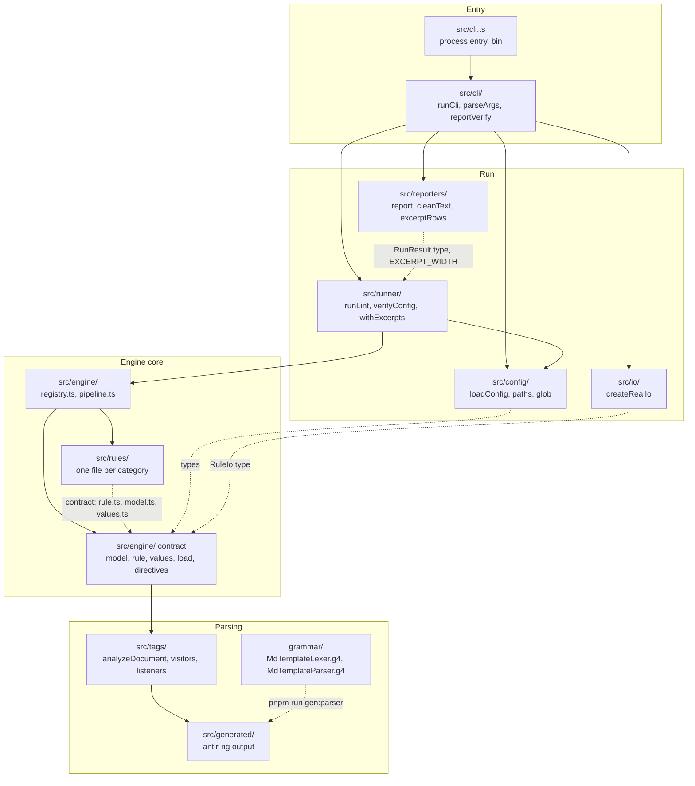
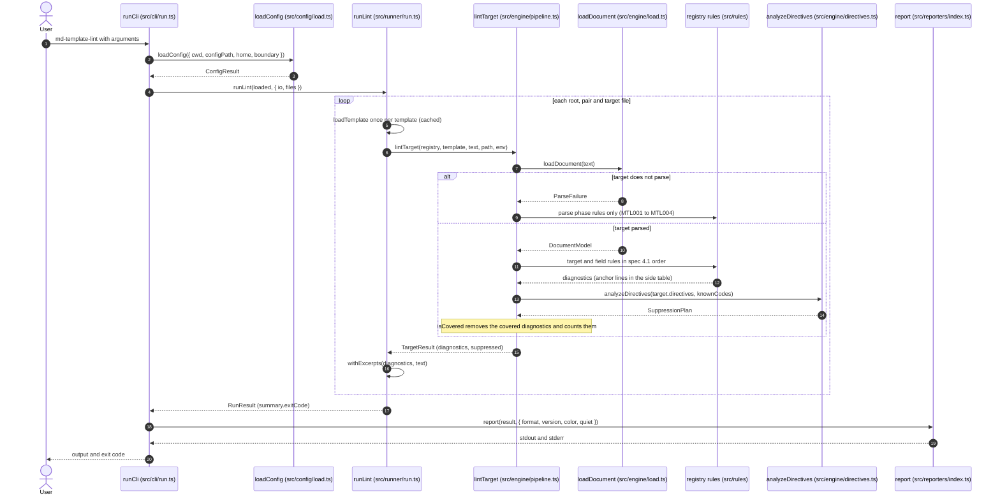
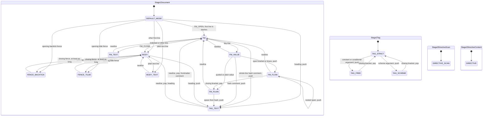
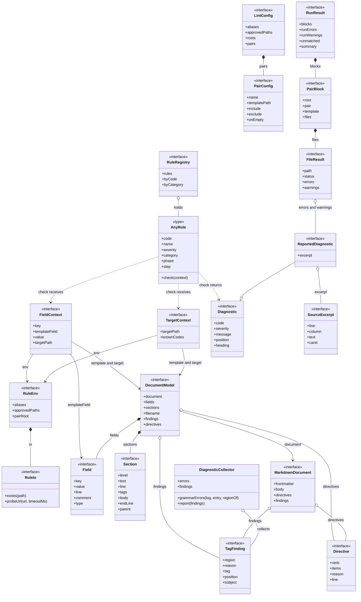

# Architecture

How the code is organised and why. The contract is [spec.md](spec.md); the grammar decisions are in
[ADR 0002](adr/0002-grammar-structure.md). When this file and the spec disagree, the spec wins.

## Overview

`md-template-lint` checks Markdown files (frontmatter and headings of every level, H1 to H6) against Markdown
templates. A template is the schema: its inline comments and heading suffixes carry bracket
tags. The tags are specified once, in the two ANTLR grammars in `grammar/`. A run goes in four
steps: the config loader reads `md-template-lint.yml` (pairs of template and glob), the runner
walks the targets of each pair, the pipeline parses each file and runs the rules of
`src/rules/<category>.ts` in a fixed order, and a reporter prints the diagnostics
(`MTLnnn` codes) as text, plain text or JSON. The CLI wraps these steps and sets the exit code.
The sections below detail each part.

Guides:

- [Docs index](README.md): everything under `docs/`.
- [README](../README.md): install, usage, rule syntax by category, config reference, lint-staged.
- [Adding a rule](guides/adding-a-rule.md): step by step with `pnpm run new:rule`, fixtures,
  consistency tests. The older single-file version is [adding-a-rule.md](adding-a-rule.md).
- [Adding a tag](guides/adding-a-tag.md): the five places, then the rule that uses the tag.
- [Grammar and listeners](guides/grammar-and-listeners.md): lexer modes, the two parse stages,
  visitors, error listeners, the generated parser.
- [Testing](guides/testing.md): syntax, target, unit, integration and consistency tests, fixtures, gates.
- [Glossary](glossary.md): the terms of this file in one place.
- [Migration](migration.md): replace the legacy wrappers and `approved_path.yml`.
- [Contributing](../CONTRIBUTING.md): setup, gates, commit style, ADR process.
- [ADR 0006](adr/0006-parity-reached.md): result of the comparison with the legacy linter.

Contents: [Modules](#modules), [Layers and dependency rules](#layers-and-dependency-rules),
[Where the codes live](#where-the-codes-live), [Extension points](#extension-points),
[Run flow](#run-flow-config-runner-pipeline-reporters) (with the
[sequence diagram](#sequence-of-one-lint-run)), [CLI](#cli) (with the
[`--verify` flowchart](#--verify)), [Data flow](#data-flow), [Lexer modes](#lexer-modes),
[Listeners and error flow](#listeners-and-error-flow), [Main types](#main-types),
[Rule contract](#rule-contract), [Discrepancies](#discrepancies). The arrows of the layers
flowchart are explained in the [Legend](#legend).

## Legend

Meaning of the arrows in the layers flowchart of [Layers and dependency rules](#layers-and-dependency-rules).
The sequence, `--verify`, state and class diagrams use the standard Mermaid meaning of their own arrows.

| Symbol       | Meaning                                                                                                                                                                                            |
| ------------ | -------------------------------------------------------------------------------------------------------------------------------------------------------------------------------------------------- |
| Solid arrow  | Value import in the main direction of the flow.                                                                                                                                                    |
| Dotted arrow | Import of a contract by a layer that sits on the other side of the flow. `rules` import values from `engine` (`defineRule` and the `report` helper of `engine/rule.ts`); `reporters` import the value `EXCERPT_WIDTH` from `runner`; `config` and `realio` import types only. Also the generator step (`pnpm run gen:parser`). |

## Discrepancies

Places where the diagrams and the code differ.

The layers flowchart draws the main edges only. These imports exist in `src/` and are not drawn:

| Area                  | Diagram says | Code does                                                                              | Action                              |
| --------------------- | ------------ | -------------------------------------------------------------------------------------- | ----------------------------------- |
| `runner` to `rules`   | no edge      | `src/runner/schema.ts` imports the value `enumOptions`                                 | Accepted: schema check shares enums |
| `runner` to `tags`    | no edge      | `src/runner/excerpt.ts` imports the value `normalizeLineEnds`                          | Accepted                            |
| `runner` to `engine`  | no edge      | `src/runner/excerpt.ts` imports the value `anchorLineOf`                               | Accepted                            |
| `cli` to `engine`     | no edge      | `src/cli/run.ts` imports the value `createMemoryIo`                                    | Accepted                            |
| `rules` to `tags`     | no edge      | `src/rules/*.ts` (for example `syntax.ts`, `bounds.ts`, `heading.ts`) import types     | Accepted (type only)                |
| `reporters` to others | no edge      | `src/reporters/text.ts` imports types from `config` and `engine`                       | Accepted (type only)                |

## Modules

| Path                               | Role                                                                                |
| ---------------------------------- | ----------------------------------------------------------------------------------- |
| `grammar/MdTemplateLexer.g4`       | Lexer with region modes. Single source of tag syntax with the parser grammar.       |
| `grammar/MdTemplateParser.g4`      | Parser: `document`, `fm*` (frontmatter) and `body*` (body) rule families.           |
| `src/generated/`                   | antlr-ng output. Never hand-edited (`pnpm run gen:parser`, `pnpm run check:parser`). |
| `src/tags/listeners.ts`            | Collecting lexer and parser error listeners, `DiagnosticCollector`.                 |
| `src/tags/parser.ts`               | Stage 1 and stage 2 parses, visitors, typed AST (`analyzeDocument`), line endings.  |
| `src/tags/visitors/`               | One visitor per tag family, `TypeHintListener`, bracket and heading helpers.        |
| `src/tags/ast.ts`, `types.ts`      | Typed AST, tag kind lists, findings; the 17 type names.                             |
| `src/engine/load.ts`               | `loadDocument` / `loadFile`: grammar parse, YAML values, comment binding, sections. |
| `src/engine/infer.ts`, `values.ts` | Type inference (spec 3.2) and the loose value predicates (spec 3.3).                |
| `src/engine/rule.ts`               | Rule contract: categories, phases, steps, contexts, `RuleEnv`, `defineRule`, stubs. |
| `src/engine/ranges.json`           | Category code ranges (spec 4.2). Read by `rule.ts` and `scripts/new-rule.ts`.       |
| `src/engine/registry.ts`           | Loads the nine `src/rules/<category>.ts` files, validates codes, categories, steps. |
| `src/engine/directives.ts`         | Target disable directives (spec 4.4): validation, range bookkeeping, coverage rule. |
| `src/engine/pipeline.ts`           | `checkTemplate`, `lintTarget` / `checkTarget`: load, rules in spec 4.1 order, suppression. |
| `src/rules/<category>.ts`          | One file per category (spec 9). Each exports `rules: readonly AnyRule[]`.           |
| `src/config/load.ts`               | `loadConfig`: discovery, `yaml` parse, located validation (`MTL901` to `MTL908`).    |
| `src/config/paths.ts`, `glob.ts`   | One path resolver (spec 6.2, D04); globs to regex plus a walk base (spec 6.4).       |
| `src/config/types.ts`              | `LintConfig`, `PairConfig`, `ConfigResult`, `RunDiagnostic` (`MTL9xx`).              |
| `src/runner/run.ts`                | `runLint`: roots, pairs, template cache, pipeline calls, run diagnostics, exit code. |
| `src/runner/walk.ts`, `types.ts`   | Target discovery (include minus exclude, sorted); the plain-data `RunResult`.        |
| `src/reporters/`                   | `report`: `pretty`, `plain`, `json`; `cleanText` sanitizing of echoed values; `excerpt.ts` source-line rows and JSON `sourceLine`. |
| `src/io/`                          | `createRealIo`: production `RuleIo` (`exists`, hardened `probeUrl`).                 |
| `src/runner/list.ts`, `verify.ts`  | File-list matching (lint-staged mode); `verifyConfig` / `verifyPaths` (`--verify`).  |
| `src/runner/files.ts`, `template.ts` | Strict UTF-8 read and path checks; template load shared by lint and `--verify`.    |
| `src/runner/schema.ts`             | `describeTemplate`: filename convention, fields (type, rules), headings (`--verify`). |
| `src/cli.ts`, `src/cli/`           | Process entry (`bin`), `execute` catch-all, argument parser, `runCli`, `--verify` reporter, version. |
| `scripts/`                         | TypeScript scripts run by `tsx` ([ADR 0007](adr/0007-tsx-script-runner.md)): `gen-parser.ts`, `check-parser.ts`, `new-rule.ts`, `smoke-pack.ts`, `smoke/`. Package scripts `gen:parser`, `check:parser`, `new:rule`, `smoke:pack`. |

The CLI is described in [CLI](#cli) below. It calls `loadConfig`, `createRealIo`, `runLint` (or
`verifyConfig` / `verifyPaths`) and `report`, all exported from `src/index.ts`.

## Layers and dependency rules

The code is a stack of layers. A layer imports only from a layer with a lower number in this
table (the table runs from the base up). The rules below come from reading the imports of
`src/`; no check enforces them, review does.

| Layer | Paths                                                  | Imports from                                                                                 |
| ----- | ------------------------------------------------------ | -------------------------------------------------------------------------------------------- |
| 0     | `grammar/`, `src/generated/`                           | `antlr4ng` only (the generated files). The `.g4` files are inputs of `pnpm run gen:parser`.  |
| 1     | `src/tags/`                                            | `src/generated/`, `antlr4ng`. The only layer above 0 that imports `antlr4ng`.                |
| 2     | `src/engine/` contract and loaders: `model.ts`, `rule.ts`, `values.ts`, `infer.ts`, `load.ts`, `directives.ts` | `src/tags/` (AST types, `analyzeDocument`, `normalizeLineEnds`, `KNOWN_TYPE_NAMES`), `yaml`, `node:fs/promises` (`loadFile`). |
| 3     | `src/rules/<category>.ts`                              | The contract of layer 2 and the AST types of `src/tags/ast.ts`.                              |
| 4     | `src/engine/registry.ts`, `src/engine/pipeline.ts`     | `src/rules/*` (only `registry.ts` imports the rules; `src/runner/schema.ts` also imports `enumOptions` from `src/rules/type.ts`) and layer 2. `pipeline.ts` imports `registry.ts`. |
| 5     | `src/config/`, `src/io/`                               | `src/config/` imports the `RuleCode` and `Severity` types of `src/engine/model.ts` and `yaml`; `src/io/` imports the `RuleIo` types of `src/engine/rule.ts`. |
| 6     | `src/runner/`                                          | `src/config/`, `src/engine/`, `src/tags/parser.ts` (`normalizeLineEnds`); `schema.ts` also imports `enumOptions` from `src/rules/type.ts`. |
| 7     | `src/reporters/`                                       | `RunResult` and friends from `src/runner/types.ts`, `EXCERPT_WIDTH` from `src/runner/excerpt.ts`, types of `src/config/` and `src/engine/model.ts`. |
| 8     | `src/cli.ts`, `src/cli/`                               | `src/config/`, `src/io/`, `src/runner/`, `src/reporters/`, `createMemoryIo` from `src/engine/rule.ts`. |

- `src/index.ts` re-exports the package API from every layer. Nothing inside `src/` imports it.
- Only `src/tags/` and `src/generated/` know ANTLR. Everything above works on the typed AST
  (`MarkdownDocument`) and on `TagFinding` data.
- A rule file imports the engine contract and the AST types, nothing from `src/config/`,
  `src/runner/`, `src/reporters/`, `src/io/` or `src/cli/`. A rule never touches the file system or
  the network itself: it calls `context.env.io` (`RuleIo`), which the runner injects.
- Reporters get plain data (`RunResult`, `VerifyResult`) and return `{ stdout, stderr }`. They read no file.
- File reads: the config file (`src/config/load.ts`), a document (`loadFile` in `src/engine/load.ts`
  and `readUtf8` in `src/runner/files.ts`), the directory walk (`src/runner/walk.ts`), the
  `exists` and `probeUrl` of `src/io/`, the package version (`src/cli/version.ts`).
- Only `src/cli.ts` reads the process (arguments, `stdout.isTTY`, `NO_COLOR`, the working
  directory); `runCli` takes them as `env`, so tests call it without a process.
- Tag syntax lives only in `grammar/*.g4`; the YAML parsing of the frontmatter lives only in
  `src/config/load.ts` (config) and `src/engine/load.ts` (documents).



The diagram is a flowchart with subgraphs, not a C4 diagram. Arrow meanings: see the
[Legend](#legend).

## Where the codes live

Each rule category is one file in `src/rules/`, with a fixed code range (spec 4.2,
`src/engine/ranges.json`; the contract and every message are in
[spec.md 4.3](spec.md#43-code-table)). `src/engine/registry.ts` loads the nine files in the order
below (`RULE_FILES`) and rejects a code outside the range of the file.

| Codes                 | Category (file)         | Phase and step of its rules                          | Tests                                  |
| --------------------- | ----------------------- | ---------------------------------------------------- | -------------------------------------- |
| `MTL001`-`MTL004`     | `syntax` (`syntax.ts`)  | `parse`: a file that does not parse                  | `tests/syntax/syntax/`                 |
| `MTL010`-`MTL016`     | `syntax` (`syntax.ts`) | `template`, warnings: `MTL010`-`MTL013` from `TagFinding`; `MTL014`: an invalid `[pattern:"..."]`, read from the template headings; `MTL015`: a heading tag with no effect, read from the template headings; `MTL016`: a `date` or `list-of-date` field without `[format:date]` or `[format:elements:date]`, read from the template fields | `tests/syntax/syntax/` |
| `MTL017`-`MTL019`, `MTL030` | `syntax` (`syntax.ts`) | `template`, ERRORS read from the template headings (spec 2.7): `MTL017` duplicate pattern or exact text, `MTL018` `min` tag on an optional heading, `MTL019` child heading out of level order, `MTL030` order tag without repeat tag. The template stays usable (not broken) but fails: exit 1 in `--verify` and in a lint run, the targets are still linted | `tests/syntax/syntax/` |
| `MTL020`-`MTL025`     | `syntax` (`syntax.ts`)  | `target`, step `directives`: disable directive warnings | `tests/target/syntax/`              |
| `MTL100`-`MTL199`     | `filename` (`filename.ts`) | `target` step `filename`; `field` step `value-filename` | `tests/target/filename/`           |
| `MTL200`-`MTL299`     | `presence` (`presence.ts`) | `field` step `presence`; `target` step `unknown-keys` | `tests/target/presence/`           |
| `MTL300`-`MTL399`     | `format` (`format.ts`)  | `field` steps `constant`, `case`, `elements`, `scheme`, `shape` (`MTL306`-`MTL309`, last step, after `type`) | `tests/target/format/` |
| `MTL400`-`MTL499`     | `bounds` (`bounds.ts`)  | `field` steps `count`, `range`, `order`              | `tests/target/bounds/`                 |
| `MTL500`-`MTL599`     | `type` (`type.ts`)      | `field` step `type`                                  | `tests/target/type/`                   |
| `MTL600`-`MTL699`     | `heading` (`heading.ts`) | `target` step `headings`: `MTL601`, `MTL604` (file scope), `MTL603` (both scopes; `MTL602` is retired and has no rule), `MTL605`-`MTL609`, `MTL614`, `MTL617` (pattern headings, repeat sets, order), `MTL610`-`MTL612` (section scope and the sub-heading opt-out), `MTL615` (`no-extra`), `MTL616` (extra headings, the only warning), `MTL613` (`[unique-headings-names]`, no template anchor, emitted last) | `tests/target/heading/` |
| `MTL700`-`MTL799`     | `content` (`content.ts`) | `target` step `content`                             | `tests/target/content/`                |
| `MTL800`-`MTL899`     | `io` (`io.ts`)          | `field` step `io`                                    | `tests/target/io/`                     |
| `MTL900`-`MTL999`     | none: run diagnostics   | Built by `src/config/load.ts`, `src/runner/` and `src/cli/` as `RunDiagnostic` | `tests/unit/config/`, `tests/unit/runner/`, `tests/unit/cli/` |

Free ranges (no rule in `src/rules/` uses them yet): in `syntax`, `MTL005`-`MTL009` (parse sub-range),
`MTL026`-`MTL029` (kept for directives) and `MTL031`-`MTL099` (`MTL030` is the last template tag code
used); in `format`, `MTL310`-`MTL399`; in `heading`, `MTL618`-`MTL699`. One heading code is set
aside: `MTL602` is retired (the removed `[presence:exist]` tag; the rule is gone and the code
stays reserved). `MTL613`, once reserved, is the rule heading-unique-names since phase A80c (tag
`[unique-headings-names]`, spec 2.11, ADR 0013).
A code is never renumbered or reused. The
`MTL9xx` codes are not rules: they have no registry entry (a directive that names one gets
`MTL022`, see `RUN_CODES` in `src/engine/directives.ts`).

## Extension points

| You want to                         | Touch                                                                                          | Guide                                           |
| ----------------------------------- | ---------------------------------------------------------------------------------------------- | ----------------------------------------------- |
| Add a rule on existing tags         | spec 4.3 row, `src/rules/<category>.ts`, `tests/consistency/pending-rules.json` while a stub, test file, fixtures | [Adding a rule](guides/adding-a-rule.md)       |
| Add a template tag                  | `grammar/MdTemplateLexer.g4`, `grammar/MdTemplateParser.g4`, `src/tags/ast.ts`, `src/tags/visitors/`, a rule, then `pnpm run gen:parser` | [Adding a tag](guides/adding-a-tag.md)         |
| Add a disable directive verb        | `DIRECTIVE` mode and `directiveVerb` in the grammars, `DirectiveVerb` in `src/tags/ast.ts`, `VERBS` in `src/tags/visitors/directive.ts`, `analyzeDirectives` in `src/engine/directives.ts`, spec 4.4 | [Grammar and listeners](guides/grammar-and-listeners.md) |
| Add a type name                     | `KNOWN_TYPE_NAMES` in `src/tags/types.ts`, spec 3.1, `src/engine/infer.ts`, `src/rules/type.ts` | [spec.md 3](spec.md#3-types)                   |
| Add an output format                | `src/reporters/` and the `ReportFormat` and `FORMAT_NAMES` lists (`src/reporters/index.ts`, `src/cli/args.ts`) | [spec.md 8](spec.md#8-output)                  |
| Add a config key                    | `src/config/load.ts` (validation), `src/config/types.ts`, spec 6.3, README config reference     | [spec.md 6](spec.md#6-configuration-md-template-lintyml) |
| Add a step to the emission order    | `FIELD_STEPS` or `TARGET_STEPS` in `src/engine/rule.ts`, `runTargetRules` in `src/engine/pipeline.ts`, spec 4.1 | [Emission order](#emission-order-spec-41-84)   |
| Add a script                        | `scripts/<name>.ts` (run by `tsx`, [ADR 0007](adr/0007-tsx-script-runner.md)) and a `package.json` script | [Testing](guides/testing.md#scripts)           |

## Run flow: config, runner, pipeline, reporters

```text
md-template-lint.yml
  -> loadConfig({ cwd, configPath?, home?, boundary? })      src/config/load.ts
       discovery (6.1): --config, else cwd then each parent
       yaml parseDocument + LineCounter; walk the NODES (no toJS), so each error has
         file, line, column and key path; errors are collected and sorted by position
       one path resolver (6.2): ~, C:/ and C:\, /x, relative; \ read as /; .. folded
       globs compiled (6.4) -> regex + literal base directory (the walk starts there)
       -> ConfigResult { ok: true, config } | { ok: false, errors: RunDiagnostic[] }
  -> runLint(configResult, { io, registry? })                 src/runner/run.ts
       not ok: no lint, result with the config errors, exit 2
       roots: project first, then `roots` in declaration order (8.4); each root dir
         checked once (MTL909); per root the pairs that list it, in config order
       per pair-root: template stat (MTL910 / MTL911, once per pair, pair skipped);
         targets (walk, include minus exclude, sorted, template itself skipped);
         none -> MTL913 per onEmpty; template read + checkTemplate ONCE per resolved
         path (cache); broken -> TEMPLATE ERROR block, files not linted, other pairs go on;
          template errors (MTL017, MTL018, MTL019, MTL030) -> status `fail` entry on the
          template, files still linted, listed once under `Failed templates:`, exit 1
       each file: strict UTF-8 read, lintTarget(registry, template, text, rootRelativePath, env)
         env = { aliases, approvedPaths, pairRoot = root dir (D11), io }
         -> { diagnostics, suppressed }: suppressed ones are already removed (4.4 DIR9),
            their count adds up in `summary.suppressed`
         target parse failures (MTL001 to MTL004) get the `Parse error: ` prefix (4.1)
       -> RunResult { blocks, brokenTemplates, failedTemplates, runErrors, runWarnings, unmatched, summary }
  -> report(result, { format: "pretty" | "plain" | "json", version, color?, quiet? })
       -> { stdout, stderr }; run errors go to stderr as `error MTLnnn: message (file:line:col)`
```

- Exit code (spec 7.5) is `summary.exitCode`: 2 with any run error, else 1 with a failed file,
  a broken template or a template with a template error (`MTL017`, `MTL018`, `MTL019` or `MTL030`;
  the targets are still linted), else 0. The `MTL616` warning never changes the exit code. `MTL913` with `warn` is a run warning (exit 0), with `error` a run
  error (exit 2), with `ignore` nothing. Suppressed diagnostics (spec 4.4) are out of the file
  results before anything counts, so a file whose only errors are suppressed passes.
- `summary.suppressed` counts them per pair-file lint. The text formats print
  `Suppressed:   N` after `Warnings:` only when N is greater than 0 (never with `--quiet`, which
  prints no summary); JSON always has the key, between `filesWithWarnings` and
  `templatesChecked` (verify JSON: 0, after `warnings`).
- `pretty` is the wrapper layout of spec 8.2 with Unicode glyphs, ANSI color only when the caller
  passes `color: true` (the CLI decides from the terminal and `NO_COLOR`). `plain` is the same
  layout with ASCII words (`PASS`, `FAIL`, `INFO`) and never colored. `json` is spec 8.5.
- `Diagnostic.heading` (spec 8.1) is set by the pipeline for `MTL601`, `MTL603`, `MTL605`, `MTL607`, `MTL608` and
  `MTL610` (from the template heading anchor line: the template heading text, or the label of a pattern
  heading); the other heading rules set it themselves (`MTL611`: the target parent text; `MTL612`, `MTL606`,
  `MTL609`, `MTL613`, `MTL614`, `MTL615`, `MTL616`, `MTL617`: the text of the reported target heading, the first listed
  one for a finding that lists several) and `MTL701` to `MTL705` (from the section index, only when
  `reportSection` recorded one: an untagged finding gets no heading). Both anchors
  stay transient: the anchor line and the `WeakMap` indices remain the sort keys, `heading` is
  only added after the sort. `field` is not emitted (spec change C07).
- Templates and targets are read by the runner, not by the pipeline. The runner never lets a
  grammar bug pass as a user diagnostic: `InternalParseError` propagates.
- Source excerpt (spec 8.1, change C09): `src/runner/excerpt.ts` (`withExcerpts`) runs in the
  runner on the text it just read: each diagnostic gets a bounded `excerpt` (a window of at most 100
  characters, never the line; see "Source excerpt" below; `ReportedDiagnostic` in
  `src/runner/types.ts`) from its `position.line`, else its anchor line
  (`anchorLineOf`), else none; a line outside the file gives none. Target diagnostics use the
  target text (`lintFile`); `--verify` uses the template text kept by `loadTemplate`
  (`LoadedTemplate.text`) for the template diagnostics `MTL010` to `MTL019` and `MTL030`. A lint run keeps
  that text only long enough to give the template errors (`MTL017`, `MTL018`, `MTL019`, `MTL030`, the only
  template lines a lint run quotes) their excerpts, then `withoutText` drops it. The lines are numbered after
  `normalizeLineEnds` (spec 1.1), the numbering of every `line`. No file is read twice.
  `RunResult` stays plain data (no side table crosses into the reporters).

### Sequence of one lint run

One `md-template-lint` call without `--verify`, for one target file. The loop runs once per
root, pair and target, in output order (spec 8.4); the template is parsed once per resolved path
and cached (`parseOnce` in `runLint`).



## CLI

`src/cli.ts` (shebang, built to `dist/cli.js`, the package `bin`) only reads the process: arguments,
working directory, `stdout.isTTY`, `NO_COLOR` (set and not empty). It writes what `execute` returns
and sets `process.exitCode` (never `process.exit`, so a pipe is flushed). `execute`
(`src/cli/main.ts`) is `runCli` behind a catch-all: an unexpected exception (a grammar bug,
`InternalParseError`, an I/O failure, also while reading the process) is exit 2 with the fixed shape
`error: unexpected failure (<code or name>)`, for example `(EACCES)` or `(TypeError)`. The error
message is never printed, because it can carry an absolute path (the path-free policy of `readUtf8`).
All behaviour is in `runCli(argv, env)` (`src/cli/run.ts`): `argv` in,
`{ stdout, stderr, exitCode }` out, with `env = { cwd, home?, boundary?, isTty, noColor, version?,
createIo? }`, so the tests call it without a process.

```text
runCli(argv, env)
  parseArgs                                        src/cli/args.ts
    --help / -h, then --version win over everything (looked up first, before any error)
    --config <path|=path>, --format <text|plain|json> (=value too), --quiet, --verify, --, files
    MTL920 unknown option, MTL921 missing value, MTL922 bad --format value: stderr
      `error MTLnnn: message` + `Try 'md-template-lint --help' for usage.`, exit 2
  lint (default):
    loadConfig({ cwd, configPath, home, boundary })
    io = createIo({ allowPrivateNetworks: config.allowPrivateNetworks })   ONE per run, an in-memory
                                                    io (createMemoryIo) when the config failed (nothing is linted)
    runLint(loaded, { io, files? })                 files = the positional arguments, if any
    report(result, { format, version, color, quiet })
    exit code = result.summary.exitCode
  --verify:
    arguments given: verifyPaths({ cwd, home, paths })   the files ARE the templates, no config read
    none: loadConfig, then verifyConfig; no config found (MTL901, no --config) is MTL923
    reportVerify(result, ...) (src/cli/verify-report.ts); no io is built
```

- `--format text` is the `pretty` reporter, `plain` and `json` are the same names. Color only when
  `format` is `text`, stdout is a terminal and `NO_COLOR` is unset or empty. `--quiet` shrinks the text
  formats only (spec 7.1).
- Exit codes are spec 7.5 and come from the result, not from the CLI: 0 clean, 1 failed file, broken
  template or template error (also in a lint run), 2 run, config or usage error (a run error outranks a failed file). `--help` and `--version` are 0.

### File-list mode (lint-staged)

`runLint(loaded, { io, files: { cwd, home?, paths } })` (`src/runner/list.ts`, `run.ts`). Each argument
is resolved by the config resolver (`resolvePath`: relative to `cwd`, absolute with `/` or `\`, `~`,
`..` folded) and de-duplicated: the same file in two spellings (`docs/a.md`, `./docs/a.md`, the absolute
path, the backslash form) is one argument; below the root the case counts, so `DOCS\A.MD` is another
argument that matches no include (globs are case-sensitive, AS5) and never hides `docs/a.md`, in either
order. For every root and pair, a file is a target when `relativeInside(file, root, ignoreRootCase)`
matches an include glob and no exclude glob, and it is not the pair's template (`compileGlob` /
`matchesGlob` results already held by the pair). This is a path test only; no file system access.

The directories from the file system root down to the root of the pair are compared WITHOUT regard to
case on Windows (`ignoreRootCase`, default `process.platform === "win32"`; `relativeInside` in
`src/config/paths.ts` keeps its case-sensitive default for every other caller). The file system ignores
case there, so with the working directory typed `c:/projects/x` the path `C:/Projects/x/docs/a.md` that
lint-staged passes is in the project; compared case-sensitively it would be "matches no pair" and the gate
would pass silently (fail open). Only that part is folded: the rest of the path keeps its case and still
meets the case-sensitive globs. Two spellings of the root that name one target are linted once.

- A root where no pair matches any argument is skipped before the root directory is checked (no
  `MTL909` for an unrelated root). A pair with no match is silent: no `MTL913` in this mode (spec 7.4).
- A matching file that is not a regular file is `MTL912` (`target not found: <path as shown>`), once per
  file whatever the number of pairs, exit 2. The other files are still linted (change C01).
- A file that matches no pair on any root is skipped and listed in `RunResult.unmatched` (printed
  paths: relative to the working directory when inside it, else absolute, always `/`). The JSON
  document has it; the text formats do not print it. A file that does not exist and matches no pair is
  also only skipped (assumption: the path test comes first, as in spec 7.2: "a file matching no pair
  is ignored silently").
- Output order is spec 8.4 (root, pair, sorted path), not argument order. A file matching two pairs is
  linted once per pair.
- Long lists: the arguments are one array and matching is linear in files times pairs and roots; there
  is no limit in the tool. lint-staged splits a very long list into several calls (the shell limit,
  for example 8191 characters in `cmd.exe`); every call is an independent run with its own summary.

### `--verify`

The two flows of `runCli` side by side. Lint reads the targets and runs every rule; `--verify`
reads only templates, builds no io and probes no URL.


`src/runner/verify.ts` parses each DISTINCT template once (dedupe by resolved path, pair order) with
`loadTemplate` (the same function the lint run uses) and returns a `VerifyResult` (`mode: "verify"`).
No target is read, no io exists, no URL is probed. Broken (`MTL001` to `MTL004`, also a file that is not
UTF-8) is `TEMPLATE ERROR` and exit 1; a missing template is `MTL910` and a directory `MTL911` (exit 2,
no `(pair '...')` suffix when the path came from the command line); tag warnings `MTL010` to `MTL016`
do not fail. The template errors `MTL017`, `MTL018`, `MTL019` and `MTL030` (`VerifyTemplate.errors`,
counted in `summary.errors`) make an ok template FAIL (exit 1) without making it broken: its schema is
still printed. A run error outranks a broken or failed template: one missing and one broken template is
exit 2 (spec 7.5), and both are still reported.

The schema of an ok template (`src/runner/schema.ts`, `describeTemplate`) is plain data read from the
`DocumentModel` the engine built (inferred field types, parsed tags, sections of every level H1 to H6); there is no
second parser. It has `filenameCase` (the `[filename:case:...]` convention or null), `uniqueHeadingNames`
(true when the template-wide `# [unique-headings-names]` line is written, spec 2.11), `fields`
(`name`, `type`, `rules[]`) and `headings` (`level`, `text`, `rules[]`).

Rule tokens spell the tag without brackets: `presence:required|optional|template-only` or
`presence:conditional:<text>`, `format:constant:<v>`, `format:snake_case|kebab-case`, `format:elements:<style>`, `format:semver`, `format:date`,
`format:elements:semver`, `format:elements:date`, `value:filename`,
`count:min:N`, `count:max:N`, `range:min:<n>`, `range:max:<n>`, `order:ascending`,
`format:scheme:<a,b>` (sorted, unique), `io:exists`, `enum:<a|b>` (field type `enum`, options from the
value split on ` | `, the one `enumOptions` of `src/rules/type.ts`, shown for fields whose type is `enum`
only). Field order is the spec 8.3 order: presence, constant, case, elements case, shape
(`format:semver`, `format:date`), elements shape (`format:elements:semver`, `format:elements:date`),
value-filename, count min and max, range min and max, order, scheme, io, enum. When a tag kind that
can appear once is written twice the first one counts (spec 2.1). Presence is ALWAYS the first rule, as
in the legacy `describe()`: the effective mode (conditional, then optional, then required; `required`
when no presence tag is written), and a conditional one carries the text of its first tag
(`presence:conditional:only when risky`). Headings: presence first (conditional, template-only,
optional, required, always printed), then the pattern tags right after it (`pattern:"<pattern>"`,
`repeat-rules:same-level`, `repeat-rules:same-level:min:N`, `repeat-rules:same-level:max:N`, the order
tag such as `order:ascending` or `order:first:date:descending`; each kind once, the first tag counts,
printed as written even when `MTL014` or `MTL015` says it has no effect), then `content:non-empty`,
`content:table`, `content:list`, `content:min-lines:N`, `content:max-lines:N`,
`content:subheadings:disallow`, `content:subheadings:no-extra`, `unique-headings-names` (last). Every heading level is
listed, in template order, with `#` repeated `level` times (spec 8.3, change C10).

Text (`src/cli/verify-report.ts`), per ok template: `  ✓ <path>` (`PASS` in plain), the
`Filename: [filename:case:<c>]` line only when declared, the `Unique heading names: [unique-headings-names]` line
only when the template-wide switch is written (right after `Filename:`, spec 8.3), the `Field  Type  Rules` table (name and type
columns padded to the widest, two spaces between columns, `-` for no rule, and under the header a run of
`-` of the HEADER LENGTH as in spec 8.3 and the legacy `describe()`: 20 for `Field  Type    Rules`, 18 for a
template with no field, where the table is these two lines only), `Headings:` (`  ## Text (rules)`; the
section and its blank line are left out when the template has no heading), then
the sections `Unknown tags found (typo or unimplemented feature):` (fields first, then headings),
`Malformed tags:` (`MTL012`), `Misplaced tags:` (`MTL013`), `Invalid patterns:` (`MTL014`),
`Conflicting tags:` (`MTL015`), `Date fields without format:` (`MTL016`), then the template error sections
`Duplicate patterns:` (`MTL017`), `Optional headings with a minimum:` (`MTL018`),
`Child headings out of level order:` (`MTL019`) and `Order tags without repeat:` (`MTL030`), always in this
order whatever the order in the template (every section but the first lists `(line L, column C)` and the
excerpt of its template line). The first six come from the template warnings, the last four from the template errors, so a
template with no tag problem has none of them. A template with at least one template error prints `✗ <path>`
(`FAIL` in plain) instead of the pass header, the summary gains `Errors: <n>` and `All templates passed!` is
not printed. A malformed or misplaced heading tag stays in the heading text (the heading extraction keeps a
bracket it does not recognise, spec 2.6); that is implementation-defined, spec 8.3 covers unknown heading
tags only. Every echoed string (field names, types, rules, heading texts) goes through `cleanText`. A broken template is
`  TEMPLATE ERROR: <path> - <message>` instead. `--quiet` hides the schema and shows only broken
templates, templates with a template error (fail header and error sections) and run errors.

JSON is `mode: "verify"` with `templates[]` of `{ path, status, error?, filenameCase, uniqueHeadingNames, fields,
headings, diagnostics }` (`status` is `ok`, `broken` or `fail`; a broken template has `error`, `filenameCase: null`,
`uniqueHeadingNames: false` and empty `fields`, `headings`, `diagnostics`; `diagnostics` of an ok or failed one are its template errors,
then its tag warnings, each with `line`, `column` and `sourceLine`, the template line), `runErrors`,
`runWarnings`, `summary` (with `errors`, the number of template errors, right after `broken`).

## Reporter sanitizing and UNC paths

`cleanText` (`src/reporters/sanitize.ts`) is applied to every echoed string in all three formats
(messages, headings, paths, descriptions, pair and root names). Line breaks and other
whitespace controls become one space, every other C0/C1 control, DEL, the bidi controls
(U+202A to U+202E, U+2066 to U+2069, U+200E, U+200F, U+061C), U+FEFF and the invisible format
characters (U+00AD, U+180E, U+200B to U+200D, U+2060 to U+2064, U+FFF9 to U+FFFB, U+E0000 to
U+E007F) are shown as `\xNN`, `\uNNNN` or, above U+FFFF, `\u{NNNNN}` (spec 8.2 EX3). A document value holding an ANSI escape therefore cannot move the cursor, clear the
screen or flip the text direction of a terminal, a CI log or a JSON viewer.

UNC paths: EVERY path value of the config is resolved lexically and may be UNC
(`\\server\share`, read as `//server/share`): `aliases`, `approvedPaths`, `roots`, `template`
and `templateRoot`. On Windows, any file system access to such a path (`exists` for an alias or
an approved path, the directory listing of a root, the read of a template) makes the operating
system open the share, which sends the user's NTLM credentials to that server over SMB
(credential disclosure or relay, OWASP A10). The tool does not block UNC values: the config
file is trusted (spec 2.8 trust boundary). Configure a UNC path only for a server you trust,
and review a config from an untrusted source before running it. Document values are not part of
this: they only feed `exists` and are gated by `approvedPaths`.

### Source excerpt (spec 8.2 EX1 to EX9, 8.3, 8.5)

The runner builds a bounded window per diagnostic (`src/runner/excerpt.ts`); `src/reporters/excerpt.ts`
formats it, and nothing else reads source text:

- Bounded cost and memory (EX8). `withExcerpts` normalizes and splits the file text once, then prepares
  each source line that has a diagnostic once
  per file (`prepare`: one pass, plus a `Uint32Array` of character offsets only when the line holds
  surrogates), cached by line number while that file's diagnostics are matched. Each diagnostic then
  costs `EXCERPT_WIDTH` characters: it keeps `text` (the window, at most 100 characters), `before` and
  `after` (characters cut on each side), `caret` (index in `text`) and, for the JSON `sourceLine`, `head`
  (the first 100 characters) and `headCut`. Every kept string is a copy that owns its characters
  (`Array.from(piece).join("")`): a slice would keep the whole file text alive through V8 sliced strings.
  The reporters never see the line, so 2000 diagnostics on one 1 MB line cost a few passes, not 2000.
  Lint mode drops the template text after parsing (`withoutText`, `src/runner/template.ts`); `--verify`
  holds it only until the tag warnings have their excerpts.
- `excerptRows(excerpt, indent)`: the gutter row (`<n> | <text>`) and, when the excerpt has a
  column, the caret row. The text goes through `cleanChar` (`sanitize.ts`), the per-character
  form of `cleanText` that does not collapse whitespace runs, so the caret stays under its
  character: a tab is one space, a control, bidi or invisible format character its `\xNN`, `\uNNNN`
  or (above U+FFFF) `\u{NNNNN}` escape. The window is at most 100 characters; a column above 100
  slides it to start 40 characters before; `...` marks a cut side. The caret offset counts the shown
  width (escapes in full, ellipsis included).
- `sourceLineOf(excerpt)`: the JSON `sourceLine`, the first 100 characters (plus `...` only when the
  line is longer, `headCut`), and only for an excerpt with a column (`head`). An anchor-only excerpt (no `line` in JSON, DIR5) is text only.
- `text.ts` prints the rows under each shown diagnostic at indent 8 (gray, SGR 90, with color), so
  `--quiet` shows exactly the excerpts of the diagnostics it shows. `json.ts` and
  `src/cli/verify-report.ts` add `sourceLine` right after `column`. `--verify` text prints the rows
  at indent 6 under each item of the tag sections, in gray with color.
- An excerpt echoes document content (frontmatter values included) into terminal and CI logs (EX9).

## Production RuleIo (`src/io/`)

`createRealIo({ allowPrivateNetworks?, fetch?, resolve?, maxUrls?, hardCapMs? })` returns the
`RuleIo` the runner is given (`runLint` takes `io` as a required option, like `checkTarget`).

| Requirement (A12.11, OWASP A10) | Where                                                                          |
| ------------------------------- | ------------------------------------------------------------------------------ |
| Scheme allow-list `http`, `https`, before any I/O | `probe` in `src/io/index.ts`; others: `unsupported scheme`      |
| `redirect: "manual"`, 3xx is reachable, never followed | request init; the default transport never follows        |
| Blocked by default: 0.0.0.0/8, loopback, link-local (169.254/16, fe80::/10), multicast and reserved, cloud metadata, IPv4-mapped, -compatible and -translated IPv6, Teredo, NAT64 local use, every IPv6 outside 2000::/3 and fc00::/7, `localhost`, numeric IP spellings | `src/io/address.ts`, `hostProblem` |
| Private ranges (RFC 1918, 100.64.0.0/10, fc00::/7) only with `allowPrivateNetworks: true` in the config | `isAddressAllowed`; loopback, link-local and metadata stay blocked |
| RESOLVED address checked, at connect time too (DNS rebinding) | pre-check in `hostProblem`; `createGuardedLookup` in the default transport (`src/io/transport.ts`) |
| Userinfo stripped, no cookies or auth header, fixed User-Agent, no proxy | `probe`; `node:http(s)` with `agent: false` ignores proxy variables |
| `AbortSignal.timeout(5000)` per request, 10 s hard cap per URL, body cancelled at once, never read | `probe` |
| Run budget: a URL is probed once, at most `maxUrls` (100) different URLs | `probeUrl` cache                     |
| Never throws; reason from a fixed vocabulary | `reasonOf`: `HTTP <status>`, `timeout`, `DNS failure`, `connection refused`, `blocked address`, `unsupported scheme`, `invalid URL`, `url budget exceeded`, `request failed` |
| `exists` swallows every OS error and a NUL byte | `exists`; the rule passes the folded path it judged                    |

Numeric IP spellings (`2130706433`, `0x7f000001`, `0177.0.0.1`, `127.1`, fullwidth digits,
ideographic dots) are folded to dotted quads by the WHATWG URL parser. `hostProblem` reads the
host as written back from the URL text (any number of slashes after the scheme, so `http:/134744072/`
and `http:134744072` too; tab, LF and CR removed as the parser does) and refuses an IPv4 host that
was written any other way than its dotted quad, public address or not. When the written host cannot
be read back, the URL is refused (fail closed). A host name is resolved in its punycode form;
`localhost`, `localhost.` and `*.localhost` are refused without a lookup. A zone id (`%25eth0`) is
not valid in a URL host: `invalid URL`. The default
transport is `node:http` and `node:https` with a `lookup` hook, not `fetch`: the global `fetch`
cannot hook the address used by the socket without a second package. The transport has the
shape of `fetch` (`redirect`, `signal`, `credentials`), so tests inject a fake and the guard is
tested apart (`tests/unit/io/`).

Tests never use the network: `fetch` and `resolve` are injected, and the rebinding test
resolves to a loopback address at connect time, which is refused before any socket opens.

A16b decision on `..` traversal (ACCEPTED, spec 2.8): a relative or alias value may contain `..`
and leave the pair root or the alias root. The only operation on it is `exists`, a yes/no
answer turned into a warning; nothing is read, listed or printed from the target, so it is an
existence-only oracle. Absolute values are gated by `approvedPaths` (folded, case-sensitive
segments, fail closed), so a document cannot probe an arbitrary absolute path. The probe and
the containment test use the same lexically folded path. The config is trusted (spec 2.8): a
config author can already point `roots`, `aliases` and `template` anywhere.

Globs are case-sensitive on every OS (AS5). The walk starts at the literal base directory of a
glob and checks each base segment against the directory listing, so `Docs/*.md` never lists
`docs/` on a case-insensitive file system. Symbolic links to files are targets (spec 2.8), links
to directories are not traversed, dangling links are skipped.

## Data flow

```text
file bytes -> loadFile (strict UTF-8; failure = file-unreadable)
text -> analyzeDocument (src/tags/parser.ts)
          normalizeLineEnds (BOM, CRLF, CR; shared with load.ts)
          stage 1: lexer modes + parser `document`  -> parse tree
          stage 2: each `[word:` bracket re-lexed in TAG_STRICT -> tag or finding
          directives (spec 4.4): the text re-lexed in DIRECTIVE_SCAN (body lines outside
            the frontmatter and the fences), comments paired outside code spans, each
            comment content (and each frontmatter `#` comment) re-lexed in DIRECTIVE
            -> `MarkdownDocument.directives` (parse data; validated and applied by the
               engine, src/engine/directives.ts)
          visitors (one per family) -> typed AST; TypeHintListener -> hints
          listeners -> DiagnosticCollector { grammarErrors, findings }
     -> loadDocument (src/engine/load.ts)
          no frontmatter / bad YAML / not a mapping -> ParseFailure
          `yaml` (failsafe, uniqueKeys false) -> values
          comment of key line N  <-> YAML key node on line N  (spec 2.1)
          findings kept only on YAML key lines, filename lines and the body
          directives kept in the body, on YAML key lines and on column-1 comment lines
            outside a multi-line value (DIR3)
          headings H1..H6 -> sections (level, text, tags, body, parent); inferType -> field type
     -> DocumentModel { fields, sections, filename, findings, directives }
     -> pipeline (async): parse | template | target + field rules, in order
          target: steps 2 to 7 of spec 4.1, then suppression (step 8) by the TARGET
            directives only (src/engine/directives.ts), a filter by code and anchor line
     -> Diagnostic { code, severity, message, position } (+ anchor line in a side table)
```

## Lexer modes

`grammar/MdTemplateLexer.g4` has one lexer and 16 modes (`DEFAULT_MODE` plus 15 `mode` blocks).
The modes are the regions of a document. Stage 1 starts in `DEFAULT_MODE` over the whole text
(`analyzeDocument`). Stage 2 starts a NEW lexer in one mode over a small piece of text, through
`createRecognizers(text, mode, push, map)` in `src/tags/listeners.ts`: `TAG_STRICT` over one
bracket, `DIRECTIVE_SCAN` over the whole text, `DIRECTIVE` over one comment content. No lexer rule
of stage 1 leads into those three modes, so the stage-1 tokens never change when a tag or a
directive is added. `parseInlineComment` and `parseHeadingSuffix` start in `TAG_TEXT` (pushed),
`parseFilenameComment` in `FM`. The comments of `grammar/MdTemplateLexer.g4` are the reference;
the diagram shows each `mode(...)`, `pushMode(...)` and `popMode` action of the file.



| Mode                          | Holds                                                                                             |
| ----------------------------- | ------------------------------------------------------------------------------------------------- |
| `DEFAULT_MODE`                | Start of the document: `---` opens the frontmatter, any other first line is a body line.          |
| `FM`, `FM_VALUE`, `FM_PLAIN`, `FM_FLOW`, `FM_TEXT` | Frontmatter: key lines, the value start, the rest of a value, flow collections, other lines. |
| `BODY`, `BODY_TEXT`           | Body line starts (heading, table row, list item, one-line HTML comment, blank) and plain lines.   |
| `FENCE_BACKTICK`, `FENCE_TILDE` | Inside a code fence: no heading, no tag. The closing fence must be at least as long as the opening one (the only embedded code). |
| `TAG_TEXT`                    | Text of an inline comment or a heading (stage 1): brackets, type hints, words, no tag keyword.    |
| `TAG_STRICT`                  | One bracket of a known family re-lexed strictly (stage 2): tag keywords live here only.           |
| `TAG_FREE`, `TAG_SCHEME`      | Free text argument (`constant:`, `conditional:`) and scheme list argument (`scheme:`).             |
| `DIRECTIVE_SCAN`              | One target re-lexed: comment markers, backtick runs, text (spec 4.4). `scanComments` pairs them.  |
| `DIRECTIVE`                   | The content of one comment: the keyword, the verbs, codes, the `--` reason.                       |

The diagram groups the modes by the parse stage that starts a lexer in them (the four boxes). A `DS_*` rule of `DEFAULT_MODE` mirrors
a `B_*` rule of `BODY`; `pnpm run check:rules` checks that mirror
([consistency check](#consistency-check)). More on the stages and the modes:
[Grammar and listeners](guides/grammar-and-listeners.md).

## Listeners and error flow

| Listener or visitor   | Runs on                                       | Reports to                         |
| --------------------- | --------------------------------------------- | ---------------------------------- |
| `LexerErrorListener`  | every lexer (stage 1, stage 2, entry helpers) | the `SyntaxEventLog` of that parse |
| `ParserErrorListener` | every parser (same)                           | the `SyntaxEventLog` of that parse |
| family visitors       | stage-2 parse tree of one bracket             | tag data, located by `parser.ts`   |
| `TypeHintListener`    | stage-1 tree of an inline comment             | hints, located by the session map  |
| `DirectiveVisitor`    | `directiveEntry` tree of one comment content  | directive data, located by `parser.ts` |
| `DiagnosticCollector` | one whole document parse                      | `DocumentAnalysis`                 |

- Both error listeners map the ANTLR line and column through a `PositionMap`. For a stage-2
  bracket the map adds the bracket offset, so every location is a file position.
- Stage-1 events (the `document` parse and the entry helpers) are grammar bugs: the collector
  stores them as `GrammarError` (region, entry rule, source, position, offending text, ANTLR
  message). `analyzeDocument` returns them with `document: null`; `parseDocument` and
  `loadDocument` throw `InternalParseError` carrying all of them. They are never user
  diagnostics.
- Stage-2 events are expected user input. The first event of `fmTagEntry` / `bodyTagEntry`
  becomes a `malformed` finding at the offending token, or `wrong-region` when the other
  region accepts the bracket. Probes (`tagFamilyEntry`, the other-region retry) keep their
  events local. Exception: `directiveScanEntry` and `directiveEntry` accept any input, so
  their events are grammar bugs (`GrammarError`) like stage 1.
- Findings (`unknown`, `malformed`, `wrong-region`) go to the collector in source order.
  `loadDocument` filters them (spec 2.1) into `DocumentModel.findings`; the `template` phase
  rules of `src/rules/syntax.ts` turn them into `MTL010` to `MTL013` (`MTL014` and `MTL015` and the template
  errors `MTL017`, `MTL018`, `MTL019` and `MTL030` are read from the template headings, `MTL016` from the
  template fields, not from a finding). Parse failures run the
  `parse` phase rules (`MTL001` to `MTL004`).
- Reporters print the `Diagnostic` list: target diagnostics with the `Parse error: ` or
  `TEMPLATE ERROR` forms of spec 4.3 (template warnings in `--verify` are printed by
  `src/cli/verify-report.ts`).

## Main types

The types a contributor meets first, where they are declared, and how they hold each other. All
are plain data except `DiagnosticCollector` and `SyntaxEventLog`, which are classes.

| Type                                              | Declared in                | Role                                                                   |
| ------------------------------------------------- | -------------------------- | ---------------------------------------------------------------------- |
| `MarkdownDocument`, `Directive`, `TagFinding`     | `src/tags/ast.ts`          | Typed AST of one file: frontmatter, body blocks, directives, tag problems. |
| `DiagnosticCollector`, `SyntaxEventLog`           | `src/tags/listeners.ts`    | Sink of one document parse (grammar errors and findings), and the event list of one lexer and parser pair. |
| `DocumentModel`, `Field`, `Section`, `Diagnostic` | `src/engine/model.ts`      | A loaded template or target; one frontmatter key; one heading section of any level (H1 to H6, with its parent); one finding. |
| `AnyRule`, `FieldContext`, `TargetContext`, `RuleEnv`, `RuleIo` | `src/engine/rule.ts` | The rule contract: what a check receives and what it may call. |
| `RuleRegistry`                                    | `src/engine/registry.ts`   | Every rule, by code and by category.                                   |
| `SuppressionPlan`, `DirectiveAnalysis`            | `src/engine/directives.ts` | What the valid directives of one target cover; the problems behind `MTL020` to `MTL025`. |
| `LintConfig`, `PairConfig`                        | `src/config/types.ts`      | A validated `md-template-lint.yml`; one pair of template and globs.    |
| `RunResult`, `PairBlock`, `FileResult`, `ReportedDiagnostic`, `SourceExcerpt` | `src/runner/types.ts` | What the reporters print. |



`AnyRule` is a union of four rule types (`ParseRule`, `TemplateRule`, `FieldRule`, `TargetRule`);
`step` exists on the last two only. `ParseContext` and `TemplateContext` (the contexts of the
other two phases) are left out of the diagram. `AnyRule`, `FieldContext` and `TargetContext` are
described in [Rule contract](#rule-contract) below.

## Rule contract

```ts
defineRule({
  code: "MTL301", // MTL + 3 digits, inside the category range (src/engine/ranges.json)
  name: "constant-mismatch", // the spec 4.3 name
  severity: "error", // default; a check may override per diagnostic
  category: "format", // must match the file
  phase: "field", // "parse" | "template" | "field" | "target"
  step: "constant", // field and target phases only
  check: (context) => [], // Diagnostic[] or Promise<Diagnostic[]>
});
```

| Phase      | Context                                                                                    | Step         |
| ---------- | ------------------------------------------------------------------------------------------ | ------------ |
| `parse`    | `ParseContext`: role (template or target), `ParseFailure`                                  | none         |
| `template` | `TemplateContext`: the template model with its tag findings                                | none         |
| `field`    | `FieldContext`: key, template field, target value or null, both models, target path, `env` | `FieldStep`  |
| `target`   | `TargetContext`: both models, target path, `env`, `knownCodes` (spec 4.3 codes)           | `TargetStep` |

`RuleEnv` carries the config `aliases`, `approvedPaths`, the `pairRoot` and an injectable
`io` (`exists(path)`, `probeUrl(url, timeoutMs)`, never throws, `URL_PROBE_TIMEOUT_MS` is
5000). `checkTarget` takes `env` as a required argument (no default, so no caller gets an
in-memory io by accident). `createMemoryIo` and `createEnv` build the in-memory one for
tests: no network.

The registry throws `RegistryError` on a duplicate code, a category that does not match its
file, a code outside the range, or a missing, unknown or unexpected `step`.

### Heading and section model (spec 2.6, change C10)

Matching is positional since change C12 (spec 2.10, ADR 0012). Every heading level is a `Section` (`src/engine/model.ts`): `level` 1 to 6, `text` (tags removed), `line`,
`tags`, `body`, `endLine` and `parent`. The parent is the index, in `DocumentModel.sections`, of the nearest
preceding heading with a lower level (null when none).

Headings are matched by POSITION, not by search. The template headings of one level and one scope form a
SEQUENCE of positions, in template order. The sequence takes the target headings of the same level and scope
(the SIBLINGS, in file order) as ONE ADJACENT RUN, greedy first-fit, with no gaps and no backtracking
(`positionalRun` in `src/engine/model.ts`). A scope is the whole file (H1, H2, and a heading without a
template parent: one run per level) or, for H3 to H6 with a template parent, the target section of one match
(or instance) of that parent (one run per level and per parent match). The siblings are walked with a cursor
that only moves forward:

1. Set aside: every sibling whose text equals a checked `[presence:template-only]` heading of the sequence
   leaves the run (`HeadingRun.setAside`); the first one is reported once (`MTL603`).
2. Positions, in template order. An exact-text position (or a pattern without placeholder) takes the next
   sibling when its text matches, else nothing. A pattern position with placeholders takes the next sibling
   when the pattern matches; when it does not and the position is required, the sibling is taken as a
   MISMATCH (`MTL606`); an optional or conditional position takes nothing. A repeat position
   (`[repeat-rules:same-level...]`) then takes every next sibling that matches: the INSTANCES, the repeat
   set of the heading in that scope.
3. Tail: the siblings left after the last position are the extra headings (`HeadingRun.tail`). They are
   allowed. A tail sibling that matches a repeat pattern is reported by `MTL614`, one under `[content:subheadings:no-extra]`
   by `MTL615`, one under `[content:subheadings:disallow]` by `MTL612`, and the others are listed in one
   `MTL616` warning per run. A run without position has no tail.

`matchHeadings(template, target)` gives, for each template heading in template order (one entry per instance of
a repeat heading, and one per parent match or instance in section scope), a `HeadingMatch`:

- `scope`: `file` or `section`, as above; `parentMatch` is the target match of the template parent (section scope).
- `match`: the sibling its position took (the instance of this entry for a repeat heading), null when it took
  nothing, took only a mismatch (`mismatch`), is not checked or is `[presence:template-only]`. `instance` is
  the rank of the entry (0 for the first instance, the one the order lists `MTL604` and `MTL611` read).
  The old `textMatch` field is removed; `match` is the only matched-sibling field.
- `run`: the `HeadingRun` of its level and scope, with its `positions` (each with `next`, `mismatch`,
  `instances`, `foundLater` and `repeatMisses`), the `setAside` siblings and the `tail`.
- `foundLater`: for an exact-text position that took nothing, the first sibling from the cursor onward with the
  same text; it only adds the "found later at line N, out of order" hint to `MTL601` (a swapped pair is a
  missing heading) and changes no match.
- `checked`: false for a heading with an invalid pattern (`MTL014`, it is no position); true for every other
  file-scope heading; for a section-scope heading only when its parent is checked, matched and not
  `[presence:template-only]`. A heading that is not checked gives no finding of any code, so a missing parent
  is reported once.

The rules of `src/rules/heading.ts` all read `matchHeadings`: `MTL601` (exact-text heading without match, file
scope), `MTL604` (order of the file-scope matches across levels) and `MTL610` (section scope), `MTL605`
to `MTL609` (pattern headings: missing, mismatch, repeat minimum and maximum, order), `MTL614` (repeat match in the
tail), `MTL617` (order key missing), `MTL611` (order of the direct children of one parent, anchored on the
target parent heading), `MTL612` and `MTL615` (the `[content:subheadings:disallow]` and
`[content:subheadings:no-extra]` opt-outs), `MTL616` (extra headings, the only warning, exit code
unchanged) and `MTL613` (duplicate names in the `[unique-headings-names]` scopes: the whole file, or
the region of each match of a tagged heading). `MTL015` (template phase, in `src/rules/syntax.ts`) warns when a heading tag has no effect, for
example on a `[presence:template-only]` heading; the template errors `MTL017` (duplicate pattern or exact text),
`MTL018` (`min` on an optional heading), `MTL019` (child out of level order) and `MTL030` (order tag without
repeat tag) are read from the template headings in the same phase. The content rules (`MTL701` to `MTL705`)
check the section of every `match` (every instance of a repeat heading), and label it
`Section '{parent} > {text}'` for a section-scope heading.

### Emission order (spec 4.1, 8.4)

`lintTarget` (and `checkTarget`, the same without the suppressed count) is async and awaits
each check before the next, so io timing never changes the order:

1. a parse failure runs only the `parse` rules;
2. `target` rules of step `filename`;
3. for each TEMPLATE field in template order: if the target value is missing or empty (blank
   string or empty list), only the `field` rules of step `presence` (the single guard);
   otherwise the `field` rules of the steps `constant`, `count`, `range`, `order`, `scheme`,
   `io`, `value-filename`, `case`, `elements`, `type`, `shape` (`MTL306` to `MTL309`, spec 2.9),
   in that order;
4. `target` rules of steps `unknown-keys`, `headings`, `content`;
5. `target` rules of step `directives` (`MTL020` to `MTL025`, spec 4.1 step 7);
6. suppression (spec 4.1 step 8): the TARGET directives (`DocumentModel.directives` of the
   target; a template is never read for them) give a plan (`analyzeDirectives` in
   `src/engine/directives.ts`), and every diagnostic it covers (`isCovered`: code and anchor
   line, DIR7) is removed and counted. The rules ran in full; this is a pure output filter.
   `MTL020` to `MTL025` are not suppressible (DIR6), so they are never removed.

Inside one step: registry order (category file order, then file order). The result lists
errors first, then warnings, each in emission order.

One exception, the `headings` step (kept from the legacy linter): the findings about one template
heading (`MTL601`, `MTL603`, `MTL605` to `MTL609`, `MTL610`, `MTL614`, `MTL617`; `MTL611` on its parent;
`MTL612`, `MTL615` on the tagged heading; `MTL616` on the last position of its run, spec 4.1
step 5) come in TEMPLATE HEADING order, interleaved across the rules, not grouped by rule. Each
of these rules anchors its finding on the line of the template heading it is about (the
diagnostic `position`). After the step ran, the pipeline stable-sorts the anchored findings by
that line (one heading keeps registry order), clears the anchor (it is a template line, not a
target location) and appends the findings without an anchor last, in registry order: `MTL604`,
which concerns the whole heading list, then `MTL613` (unique heading names, spec 2.11), which
concerns target text, not one template heading, in target line order.

Second exception, the `io` step (legacy `_check_io_exists`): the findings `MTL801` to `MTL805`
of one field come in ITEM order, interleaved across the five rules, not grouped by rule (a list
`["docs/missing.md", "@gone/a.png"]` gives `MTL804` then `MTL801`). Each io rule reports through
`reportItem(rule, message, index)` (`src/engine/rule.ts`), which records the item index in a side
table (a `WeakMap`), never on the `Diagnostic`. After the step ran for one field, the pipeline
stable-sorts its findings by that index (`byItemIndex`; one item keeps registry order). Reporters
therefore never see the index: a diagnostic has exactly `code`, `severity`, `message`,
`position`. Fields stay in template order.

Third exception, the `content` step (legacy `validate_content`): the findings `MTL701` to
`MTL705` come in TEMPLATE SECTION order, interleaved across the five rules, not grouped by rule
(two empty sections `## A [content:table]` and `## B [content:non-empty]` give `MTL702` for A
then `MTL701` for B). Each content rule reports through `reportSection(rule, message, index, anchorLine = null)`
(`src/engine/rule.ts`; pass the target line as `anchorLine`, or no line directive can cover the finding), which records the template section index in a side table (a `WeakMap`),
never on the `Diagnostic`. After the step ran, the pipeline stable-sorts its findings by that
index (`bySectionIndex`; one section keeps registry order).

Fourth exception, the `directives` step (spec 4.4 DIR8): the six directive rules share one
analysis (`directiveDiagnostics` in `src/engine/directives.ts`: each rule keeps its own
problem kinds and owns its message). Each finding carries its index in that analysis through
`reportSequenced` (a side table again), and the pipeline stable-sorts the step by it
(`bySequence`): directive source order (line, then column), item order inside one directive,
and every `MTL024` last, by the position of its `begin disable` and then the code order.

### Anchor lines (spec 4.4 DIR5)

Each diagnostic `lintTarget` returns can be resolved to its target anchor line with
`anchorLineOf(diagnostic)` (`src/engine/rule.ts`, exported by the package): a 1-based line of
the target file, or null. It is a side table (`WeakMap`), not a field, so the reporters, the
JSON output and every deep-equality test see the same `Diagnostic` as before. The coverage
rule reads it, and so does the runner (`withExcerpts`, phase A65), right after the pipeline
returns, to quote the anchored target line (see the source excerpt in the run flow above). The
reporters never read it: they get the line in `ReportedDiagnostic.excerpt` (the runner copies only
the `Parse error: ` ones, which have no anchor, and the diagnostics it adds an excerpt to).

| Diagnostics                                    | Anchor, recorded by                                              |
| ---------------------------------------------- | ---------------------------------------------------------------- |
| field steps (`MTL102`, `MTL201`, `MTL301` to `MTL517`, `MTL801` to `MTL805`; this includes `MTL306` to `MTL309` of step `shape`) | target key line of the field, none when the key is missing; the pipeline (`setAnchorLine`) |
| `MTL202`                                       | target key line (last occurrence of a duplicate key); the rule (`reportOnLine`) |
| `MTL603`                                       | the first sibling it sets aside (same level and scope, same text); the rule |
| `MTL606`, `MTL609`                             | the reported target heading (the mismatch; the later heading of the first pair out of order); the rule |
| `MTL607`, `MTL608`                             | the first instance of the repeat set (none without instance); the instance number `max + 1`; the rule |
| `MTL614`, `MTL616`, `MTL617`                   | the first heading the finding lists (one diagnostic, so a line directive on that line removes it whole); the rule |
| `MTL610`, `MTL611`                             | target parent heading (the match of the template parent); the rule |
| `MTL612`, `MTL613`, `MTL615`                   | the reported target heading (`MTL613`: the later duplicate); the rule |
| `MTL701` to `MTL705`                           | first target heading of the checked section; the rule            |
| `MTL020` to `MTL025`                           | the directive line (never suppressible; data for reporters)      |
| `MTL101`, `MTL601` (also with its "found later" hint, which is message text), `MTL604`, `MTL605`, parse failures, template diagnostics | none |

`MTL602` is retired (the removed `[presence:exist]` tag, now `MTL012`): spec 4.2 keeps the code reserved
and it has no anchor row.

The heading and content steps copy their diagnostics (to clear the template position or add
`heading`); the copies keep the anchor.

`checkTemplate` returns its tag warnings (`MTL010` to `MTL016`) and, apart, its template errors (`MTL017`,
`MTL018`, `MTL019`, `MTL030`), each list sorted by source position (line, then column) across rules; equal
positions keep registry order.

## How to add a tag (5 places)

Step by step with an example: [Adding a tag](guides/adding-a-tag.md).

1. `grammar/MdTemplateLexer.g4`: the keyword token(s) in mode `TAG_STRICT` only.
2. `grammar/MdTemplateParser.g4`: the `fm*` or `body*` tag rule and its alternative in
   `fmTagBody` or `bodyTagBody`, plus `tagFamily` for a new family. Run `pnpm run gen:parser`.
3. `src/tags/ast.ts`: the member of the `FrontmatterTag` or `BodyTag` union AND its kind in
   `FRONTMATTER_KIND_SET` or `BODY_KIND_SET` (same file; the compiler rejects a missing or
   extra kind).
4. `src/tags/visitors/<family>.ts`: its visitor, and `visitors/index.ts` for a new family.
5. `src/rules/<category>.ts`: the rule that consumes it (see below).

Then `pnpm run check:rules`. It derives one sample per grammar alternative from the parser
ATN, parses it through the production `document` rule and checks the visitor and the kind
lists. Only a new stage-2 token whose lexer rule is a negated set needs a sample text in
`TOKEN_SAMPLES` (`tests/consistency/consistency.ts`); the check names the token when missing.

## How to add a rule

The step by step guide is [Adding a rule](guides/adding-a-rule.md). The `pnpm run new:rule`
scaffold (flags, what it writes, pending rules, test layout and
fixtures) is described in [adding-a-rule.md](adding-a-rule.md#2-scaffold-the-rule). A new rule
needs a row in the spec 4.3 code table; a rule that adds a tag also follows the five places above.

## Tests: rule cases

How to write and run them, with the helpers and the gate order: [Testing](guides/testing.md).

Every registered rule code has one test file and one fixture folder, with at least 1 `pass-` case
and at least 1 `fail-` case. There is no upper bound: several `pass-` cases are welcome to test
limit cases. Each case has its own fixture with a descriptive kebab-case
name (`pass-<name>` / `fail-<name>`, never numbered), and the test file holds a table that maps
the case name to the fixture and the expected result. No case text is written inline.

| Family | Test file | Fixtures | Code path |
| ------ | --------- | -------- | --------- |
| Template syntax (phase `parse` or `template`: `MTL001`-`MTL004`, `MTL010`-`MTL019`, `MTL030`) | `tests/syntax/<category>/<MTLxxx>-<name>.test.ts` | `tests/fixtures/templates/<MTLxxx>/<case>.md`, one template, no target | `md-template-lint --verify --format json <case>.md` through `runCli` (`tests/helpers/verify.ts`); asserts code, severity, message, line and column, template status (`ok`, `broken` or `fail`) and exit code (0; 1 when broken or when the template has a template error `MTL017`, `MTL018`, `MTL019` or `MTL030`) |
| Target (phase `field` or `target`: `MTL020`-`MTL025`, `MTL101`-`MTL805`) | `tests/target/<category>/<MTLxxx>-<name>.test.ts` | `tests/fixtures/pairs/<MTLxxx>/<case>/template.md` + `target.md` | `checkTemplate` then `checkTarget` (or `lintTarget`) of `src/engine/pipeline.ts`; asserts the messages, severity and position of the code |

The run diagnostics `MTL9xx` are not rules (no registry entry, no rule file). They depend on a
config, a file system layout or the command line, so their cases live with the config, runner
and CLI tests below. `tests/fixtures/smoke/clean-project/` is the synthetic project that
`pnpm run smoke:pack` lints from the installed package.

`tests/consistency/rule-fixtures.ts` (run by `rule-fixtures.test.ts`, part of `check:rules`, and
on a fresh scaffold by `tests/unit/new-rule.test.ts`) enforces the layout: one fixture
family per code (syntax or target, from the phase), one test file per code, the split, the case
name format, the pair folder shape (exactly `template.md` and `target.md`), the case table equal to
the fixture listing (`name: "..."` entries outside comments), and no orphan fixture folder,
fixture case or test file. Controls outside the split (for example "no `[filename:case]` tag,
no `MTL101`") live in `tests/fixtures/rule-controls/<MTLxxx>-<name>/` and must be named by the
test of their code.

## Tests of config, runner, reporters and io

| Path                                  | Content                                                                        |
| ------------------------------------- | ------------------------------------------------------------------------------ |
| `tests/unit/config/`                  | `validate` (one error kind per fixture), `discovery`, `naming`, `bytes` (invalid UTF-8, BOM + CRLF, zero byte), `paths`, `glob`. |
| `tests/unit/runner/`                  | `inputs` (MTL909 to MTL911, exit precedence), `empty` (`onEmpty`), `broken`, `parse` (`Parse error:`), `expand`, `io-wiring`, `unreadable`, `walk`, `suppress` (spec 4.4 worked examples, `Suppressed:`, `summary.suppressed`), `excerpt` (source line under a diagnostic, `tests/fixtures/runner/excerpt-*`, generated CRLF, tab, control-character and long-line projects, `--verify` template lines). |
| `tests/unit/suppression.test.ts`, `anchors.test.ts` | Coverage of each directive verb and the parser edge cases (`tests/fixtures/suppression/<case>/`, `template.md` + `target.md`); anchor lines (DIR5). |
| `tests/unit/reporters/`               | `pretty`, `plain`, `json` against expected-output files, `cleanText`, `excerpt` (rows, window, JSON `sourceLine`). |
| `tests/unit/io/`                      | `address`, `probe` (refusal table), `probe-behaviour`, `connect-guard`, `exists`. |
| `tests/unit/cli/`                     | `usage`, `exit`, `list`, `list-large` (500+ arguments, temp folder) and `list-root-case` (root directory written in another case), `verify`, `schema` (expected table and JSON), `format`, `wiring` (injected `createIo`), `main` (catch-all), `version`, `layout`, `spawn` (`dist/cli.js`, skipped when missing or older than `src/`). |
| `tests/fixtures/cli/<case>/`          | One project per case: `exit-`, `list-`, `verify-`, `schema-` (a `template.md` with `expected.plain.txt` and `expected.json`), `format-`, `wiring-` (split), `usage-no-config` and `large-source-project` (one shared project each). |
| `tests/fixtures/config/<case>/`       | One config per case: `validate-` (split), `discover-`, `naming-`.               |
| `tests/fixtures/runner/<case>/`       | One project per case: `inputs-`, `empty-`, `broken-`, `parse-`, `suppress-` (split), `excerpt-` (split), `expand-`, `io-`, `unreadable-`, `report-`. |
| `tests/fixtures/tags/<case>/`         | One `document.md` per case (`pass-` / `fail-`), read by `tests/unit/parser-comment-line.test.ts`. |
| `tests/helpers/`                      | Fixture paths, the pass/fail split check, runner and io fakes, directive cases. |
| `tests/unit/smoke/`                   | Packaging (ADR 0005): the pure helpers of `scripts/smoke-pack.ts` and `scripts/smoke/check-release.ts` (`scripts/smoke/helpers.ts`: process invocation and quoting, tarball content, tag and repository checks, CLI expectations), `check-release.ts` as a process, and the workflows `.github/workflows/ci.yml` and `release.yml` plus the `package.json` publish fields. |
| `tests/fixtures/release/<group>/`     | One file per case (`pass-` / `fail-`): `manifest/`, `repository/` and `consumer/` (JSON: package.json fields, `repository` block, the smoke-test project after `pnpm add`) and `tarball/` (`.txt`: a `tar -tzf` listing). |

A group of fixtures shares a prefix (`inputs-`, `empty-`, `broken-`, `parse-`, `suppress-`, `validate-`), so each
test file checks that its directories are exactly its cases (no orphan). Inside a group the case names
start with `pass-` or `fail-` (naming rules: [CONTRIBUTING.md](../CONTRIBUTING.md#tests)). Groups without
a pass/fail split (`discover-`, `naming-`, `expand-`, `io-`, `unreadable-`, `report-`) list their cases
without the prefix; the configs of the `report-`, `io-` and `unreadable-` projects start with a comment
that says why. The expected-output files `expected.*` are written from the spec 8.2 and 8.5 samples, not
generated. Bytes that cannot be text fixtures (invalid UTF-8, a BOM with CRLF, symbolic links) are built
in code in a temporary folder that the test removes.

`tests/fixtures/cli/` declares its group prefixes in `KNOWN_PREFIXES` (`tests/helpers/fixtures.ts`);
`fixtureDirs` throws on a directory of that area with an unknown prefix, so a misspelled prefix cannot
hide a fixture from every group. A group owns its fixtures: a test reads a fixture of another group only
when its header says so (`exit`, `verify` and `usage` for the neutral working directory
`usage-no-config`, `spawn` for four ready-made projects).

## Consistency check

`pnpm run check:rules` (`tests/consistency/`) fails with one line per drift:

- `tagFamily` against the first keywords of `fmTagBody` and `bodyTagBody` (parser ATN);
- `tagWord` against the word tokens, `fmHintWord`, `TYPE`, `RULE` and the `TAG_TEXT` keywords;
- the visitor registry: exactly one visitor per `fmTagBody` / `bodyTagBody` alternative;
- `KNOWN_TYPE_NAMES` against spec 3.1;
- AST kinds: every grammar alternative yields one tag through `document`, each kind from one
  family, and the kinds equal the lists in `src/tags/ast.ts`;
- the 8 `DS_*` rules of `DEFAULT_MODE` against the 8 `B_*` rules of mode `BODY` (lexer ATN:
  mode membership, order, pattern, token type, next mode);
- one file per category in `src/rules/`; `src/engine/ranges.json` against spec 4.2;
- every spec 4.3 code (except `MTL9xx`) implemented or pending, never both; a stub counts as
  pending; registered rules match the spec name, category and severity;
- every registered rule code has its rule-case test file and fixtures, and no fixture is an
  orphan ("Tests: rule cases" above, `tests/consistency/rule-fixtures.test.ts`); the `MTL9xx`
  run diagnostics are not rules.

## Legacy comparison harness (removed)

A harness once compared the port with outputs captured from the legacy linter and the wrappers.
The comparison finished on 2026-10-30 with every divergence documented, and the harness was
removed, then its sample data (phase A39). See [ADR 0006](adr/0006-parity-reached.md) for the
result and the commits that keep it.

## Coverage gate

`pnpm run coverage` runs the whole suite with v8 coverage (`vitest.config.ts`) over `src/**`, minus
`src/generated/**` (generated, checked by `check:parser`) and `src/cli.ts` (process entry, reached only
through the child process of `tests/unit/cli/spawn.test.ts`, which v8 does not see; its logic is in
`src/cli/`). It exits non-zero when lines, statements, functions or branches fall under 85% in any of
`src/engine/**`, `src/rules/**`, `src/tags/**` and `src/tags/*.ts` (the parser files without the
visitors). `pnpm test` is unchanged and does not collect coverage. Defensive branches that real input
cannot reach (the grammar has a catch-all everywhere) are covered by a hand-built argument in
`tests/unit/listeners-defensive.test.ts`, or removed when dead; thresholds are never lowered.
