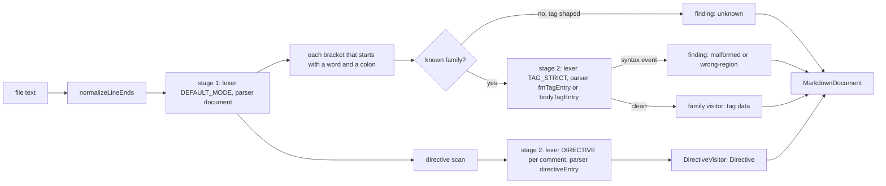
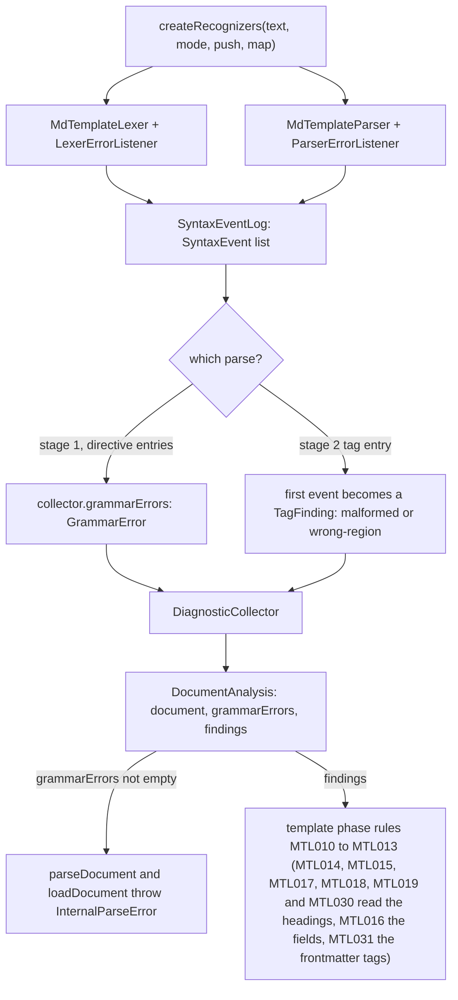

# Guide: grammar and listeners

How a Markdown file becomes a typed AST, and where each piece lives. Read it before you touch
`grammar/*.g4`, `src/tags/` or the directive code. The tag syntax is only in the two grammars; the
TypeScript in `src/tags/` never matches a tag with a regex.

Companion pages: [architecture.md](../architecture.md) ([lexer modes](../architecture.md#lexer-modes),
[listeners and error flow](../architecture.md#listeners-and-error-flow), [data flow](../architecture.md#data-flow)),
[ADR 0002](../adr/0002-grammar-structure.md), [Adding a tag](adding-a-tag.md), the
[glossary](../glossary.md).

<!-- prettier-ignore-start -->
<!-- omit in toc -->
## Summary
<!-- prettier-ignore-end -->

- [The pieces](#the-pieces)
- [Two stages](#two-stages)
- [Lexer modes in practice](#lexer-modes-in-practice)
- [Listeners and visitors](#listeners-and-visitors)
- [Error flow](#error-flow)
- [Disable directives in the grammar](#disable-directives-in-the-grammar)
- [The generated parser](#the-generated-parser)
- [See also](#see-also)

## The pieces

| Piece                      | File                          | Role                                                     |
| -------------------------- | ----------------------------- | -------------------------------------------------------- |
| Lexer grammar              | `grammar/MdTemplateLexer.g4`  | Tokens and the 18 lexer modes (regions of a document).   |
| Parser grammar             | `grammar/MdTemplateParser.g4` | Rules: `document`, `fm*`, `body*`, `tag*`, `directive*`. |
| Generated parser           | `src/generated/`              | antlr-ng output. Never hand-edited.                      |
| Error listeners, collector | `src/tags/listeners.ts`       | Collect lexer and parser errors; `DiagnosticCollector`.  |
| Orchestration              | `src/tags/parser.ts`          | `analyzeDocument`, the two stages, the typed AST.        |
| Visitors, hint listener    | `src/tags/visitors/`          | Tree to data: one visitor per tag family, helpers.       |
| Typed AST                  | `src/tags/ast.ts`             | `MarkdownDocument`, tags, `TagFinding`, `Directive`.     |

The two `.g4` files and `src/tags/ast.ts` are the contract of the tag syntax with the spec
([spec.md section 2](../spec.md#2-template-tags)). Everything above `src/tags/` works on the AST.

## Two stages

A document is parsed in two stages. The reason is error handling: a stage-1 parse can never fail on
user input (a failure is a grammar bug), and a stage-2 failure is a normal user mistake, reported as a
finding.

| Stage | Lexer starts in  | Over                       | Parser entry rule                                     | Output                                                               |
| ----- | ---------------- | -------------------------- | ----------------------------------------------------- | -------------------------------------------------------------------- |
| 1     | `DEFAULT_MODE`   | the whole text             | `document`                                            | parse tree: regions, key lines, comments, headings, fences, brackets |
| 2     | `TAG_STRICT`     | one bracket `[word:...`    | `tagFamilyEntry`, then `fmTagEntry` or `bodyTagEntry` | a tag, or a `malformed` or `wrong-region` finding                    |
| 2     | `DIRECTIVE_SCAN` | the whole text again       | `directiveScanEntry`                                  | one `directiveScanLine` per line (body only, outside fences)         |
| 2     | `DIRECTIVE`      | the content of one comment | `directiveEntry`                                      | a `Directive`, or null for prose                                     |

Helpers for one piece of text: `parseInlineComment` (starts in `TAG_TEXT`, entry `fmInlineCommentEntry`),
`parseHeadingSuffix` (`TAG_TEXT`, `bodyHeadingTextEntry`) and `parseFilenameComment` (`FM`,
`fmFilenameLineEntry`), all in `src/tags/parser.ts`.

What stage 1 does with a tag: it does not know tags. In `TAG_TEXT` a bracket is a sequence of generic
tokens (`LBRACK`, `ALNUM`, `COLON`, `NUMBER`, ...), parsed by `tagCandidate` and its siblings
(`tagRuleMarker`, `tagBareBracket`, `tagShapedBracket`, `tagProseBracket`). Stage 2 takes the bracket
text, lexes it again in `TAG_STRICT`, where the tag keywords exist, and parses it.



## Lexer modes in practice

The modes are listed, with the transitions, in
[architecture.md, Lexer modes](../architecture.md#lexer-modes). Rules for working in the lexer:

- A mode change is an action on a rule: `-> mode(X)` replaces the mode, `-> pushMode(X)` enters
  a nested one, `-> popMode` returns. `-> type(T)` gives the token another type, so the parser sees
  one token type for the same thing in several modes (for example `NL`).
- The only embedded code is the fence length: `openFence()` stores the length of the opening run and
  `closesFence()` is the predicate of the closing line (a closing fence is at least as long).
- The input contract is: line ends normalized to LF and the text ends with an LF
  (`normalizeLineEnds` and `analyzeDocument` in `src/tags/parser.ts`, [spec 1.1](../spec.md#11-what-a-template-is)).
  Every line rule can therefore require `\n`.
- `DEFAULT_MODE` mirrors the line-start rules of `BODY` with `DS_*` rules, so a first line that is not
  `---` is lexed like any body line. `pnpm run check:rules` checks the mirror: mode membership,
  order, pattern, token type and next mode of the eight `DS_*` and `B_*` pairs.
- `DIRECTIVE_SCAN` and `DIRECTIVE` are not reachable from `DEFAULT_MODE`, so the stage-1 tokens do not
  change when directives are touched.

See what the lexer does. Create the scratch file `tmp/tokens.ts` (`tmp/` is git-ignored):

```ts
import { CharStream } from "antlr4ng";
import { MdTemplateLexer } from "../src/generated/MdTemplateLexer.js";

function print(text: string, mode?: number): void {
  const lexer = new MdTemplateLexer(CharStream.fromString(text));
  if (mode !== undefined) lexer.mode = mode;
  for (const token of lexer.getAllTokens()) {
    const name = MdTemplateLexer.symbolicNames[token.type] ?? String(token.type);
    console.log(`${token.line}:${token.column}`, name, JSON.stringify(token.text));
  }
}

console.log("stage 1: the whole document, from DEFAULT_MODE");
print("---\ntitle: x # [count:min:1]\n---\n# Heading [presence:required]\n");
console.log("stage 2: one bracket, from TAG_STRICT");
print("[count:min:1]", MdTemplateLexer.TAG_STRICT);
```

```bash
pnpm exec tsx tmp/tokens.ts
```

The output starts with `FM_OPEN`, `FM_KEY`, `FM_PLAIN_TEXT`, `FM_COMMENT_HASH`, then `LBRACK ALNUM("count")
COLON ALNUM("min") COLON NUMBER RBRACK` for the comment (generic words), and ends, for the bracket
lexed from `TAG_STRICT`, with `LBRACK COUNT COLON MIN COLON NUMBER RBRACK`: the same text, but the
keywords `count` and `min` are real tokens there.

## Listeners and visitors

ANTLR gives two ways to read a parse tree. This project uses both, for different jobs.

| Name                                                        | Kind                | Where                                                | Job                                                                                    |
| ----------------------------------------------------------- | ------------------- | ---------------------------------------------------- | -------------------------------------------------------------------------------------- |
| `LexerErrorListener`                                        | error listener      | `src/tags/listeners.ts`                              | Collect the lexer's token recognition failures.                                        |
| `ParserErrorListener`                                       | error listener      | `src/tags/listeners.ts`                              | Collect the parser's syntax errors.                                                    |
| `FamilyVisitor`                                             | visitor base        | `src/tags/visitors/base.ts`                          | Answer for one parser rule, null for every other.                                      |
| `<Family>Visitor`                                           | visitor             | `src/tags/visitors/<family>.ts`                      | Tree of one tag to tag data.                                                           |
| `BracketShapeVisitor`, `HeadingVisitor`, `DirectiveVisitor` | visitors            | `visitors/brackets.ts`, `heading.ts`, `directive.ts` | Structure helpers (they are not tag families, so they are not in `visitors/index.ts`). |
| `TypeHintListener`                                          | parse tree listener | `src/tags/visitors/hints.ts`                         | Walked over a comment with `ParseTreeWalker`; collects the type hints of spec 2.4.     |

- A visitor RETURNS a value from a subtree. `FamilyVisitor<T>` keeps the first non-null result, and each
  family visitor overrides only its own method (`visitFmCountTag`, ...), so the orchestrator asks every
  visitor of a region in turn and no central `switch` over tag kinds exists
  (`FRONTMATTER_TAG_VISITORS`, `BODY_TAG_VISITORS` in `src/tags/visitors/index.ts`).
- A listener is called on entry and exit of every node during a walk and keeps state on the side
  (`TypeHintListener.hints`). Use it to collect scattered items; use a visitor to build a value.
- Both visitors and listeners return DATA without a location. `ParseSession` in
  `src/tags/parser.ts` adds `region`, `position` and `raw` (`located`).

## Error flow



- `createRecognizers` (`src/tags/listeners.ts`) builds a lexer and a parser over a text, removes the
  default console listeners, attaches the collecting ones, and starts the lexer in `mode` (or pushes it).
  Both listeners map the ANTLR line and column through a `PositionMap`, so every location is a file
  position even for a bracket lexed alone.
- Stage 1 never fails on input: it has a catch-all alternative everywhere. An event there is a grammar
  bug. It becomes a `GrammarError` (region, entry rule, position, offending text, ANTLR message), the
  analysis has `document: null`, and `parseDocument` and `loadDocument` throw `InternalParseError`. It is
  never a user diagnostic. The same holds for `directiveScanEntry` and `directiveEntry`: they accept any
  input.
- Stage 2 events are expected user input. The first event of `fmTagEntry` or `bodyTagEntry` becomes a
  `malformed` finding at the offending token, or `wrong-region` when the other region's entry accepts the
  bracket (a body tag in a comment, `MTL013`). A bracket of tag shape whose family is unknown is an
  `unknown` finding (`MTL010`, `MTL011`).
- `DiagnosticCollector` is the single sink of one document parse: `grammarErrors(...)`, `report(findings)`,
  and the read side `errors` and `findings` (findings sorted by position, stable).
- Findings are data of the tag layer. `src/rules/syntax.ts` turns them into `MTL010` to `MTL013`; codes,
  severities and messages are never in `src/tags/`. The template warnings `MTL014` (an invalid heading
  pattern), `MTL015` (a heading tag with no effect) and `MTL016` (a date field without a format tag),
  and the template errors `MTL017`, `MTL018`, `MTL019` and `MTL030` (heading pattern, minimum, child
  order and order-tag conflicts), are not findings: the same file reads them from the template headings
  and fields. The template warning `MTL031` (a `[frontmatter:optional]` copy with no effect) is read
  from `Frontmatter.optionalTags`.

Run the whole parser on a small target. Create `tmp/analyze.ts`:

```ts
import { analyzeDocument } from "../src/tags/parser.js";

const text = ["---", "title: x # [nope:y]", "# md-template-lint disable-line MTL201", "---", "## Notes <!-- md-template-lint disable-line MTL701 -->", ""].join("\n");
const analysis = analyzeDocument(text);
console.log("grammar errors:", analysis.grammarErrors.length);
console.log(
  "findings:",
  analysis.findings.map((f) => `${f.position.line}:${f.position.column} ${f.reason} ${f.tag}`),
);
console.log(
  "directives:",
  analysis.document?.directives.map((d) => `${d.line} ${d.verb} ${d.items.map((item) => item.text).join(",")}`),
);
```

```bash
pnpm exec tsx tmp/analyze.ts
```

```text
grammar errors: 0
findings: [ '2:12 unknown [nope:y]' ]
directives: [ '3 disable-line MTL201', '5 disable-line MTL701' ]
```

## Disable directives in the grammar

Spec 4.4 ([DIR1 to DIR10](../spec.md#44-disable-directives-in-target-files)) defines the directives;
this is how the parser side reads them. Only the target is read; the engine decides what they cover.

1. `analyzeDocument` builds the stage-1 tree, then the typed blocks, then the set of fenced lines
   (DIR4: no directive inside a fence).
2. Body directives: `ParseSession.bodyDirectives` lexes the text in `DIRECTIVE_SCAN`, parses
   `directiveScanEntry`, skips the lines of the frontmatter and of fences, and hands the tokens of each
   line to `scanComments` (`src/tags/visitors/directive.ts`). It pairs them left to right: a backtick
   run opens a code span closed by an equal run, a `<!--` outside a code span opens a comment closed by
   the first `-->` on the line. A comment with no `-->` on its line is never a directive (DIR3).
3. Frontmatter directives: the `#` comment of a key line or a column-1 comment line.
4. The content of each comment goes through `ParseSession.directive`: lexed in `DIRECTIVE`, parsed with
   `directiveEntry`, read by `DirectiveVisitor`. Prose (a comment that does not start with
   `md-template-lint`) gives null. `directiveEntry` never fails, so a malformed directive is data:
   `Directive.verb` is null and `Directive.word` holds the offending word.
5. The result is `MarkdownDocument.directives`. `loadDocument` (`src/engine/load.ts`) keeps the
   frontmatter ones on YAML key lines and column-1 comment lines outside a multi-line value (DIR3).
6. Validation, range bookkeeping and the coverage rule are the engine's job
   (`analyzeDirectives`, `isCovered` in `src/engine/directives.ts`; the warnings `MTL020` to `MTL025`
   in `src/rules/syntax.ts`). A new verb touches the lexer (`DIR_*` token), `directiveVerb`, the
   `DirectiveVerb` type, the `VERBS` map in `visitors/directive.ts` and `analyzeDirectives`.

## The generated parser

```bash
pnpm run gen:parser
pnpm run check:parser
```

- `gen:parser` runs `tsx scripts/gen-parser.ts` ([ADR 0007](../adr/0007-tsx-script-runner.md)): it empties
  `src/generated/`, then runs antlr-ng over the lexer and the parser grammar with the TypeScript target and
  the visitor and listener options. No Java.
- `check:parser` (`scripts/check-parser.ts`) generates into a temporary directory and compares it with
  `src/generated/`: a differing, missing or extra file fails. It never modifies `src/generated/`, and it
  works before and after the files are committed.
- Commit the regenerated files with the grammar change. Never edit `src/generated/` by hand.

## See also

- [Adding a tag](adding-a-tag.md): the five places, step by step.
- [Testing](testing.md): the parser tests (`tests/unit/tags/tags.test.ts`, `tests/unit/tags/visitors.test.ts`,
  `directives.test.ts`, `listeners.test.ts`) and the consistency check.
- [Architecture](../architecture.md), [spec.md section 2](../spec.md#2-template-tags), [glossary](../glossary.md).
