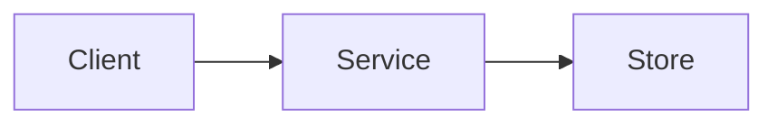

---
# [unique-headings-names]
title: Architecture overview # [presence:required]
last_updated: 2026-11-11 # [presence:required] [format:date] [date]
---

# Architecture title [pattern:"{text}"]

One paragraph: the shape of the system in plain words. Link the product and
technical specifications.

## Summary [presence:optional] [content:non-empty]

- Table of contents: one link per section.

## Overview [content:non-empty]

The system at a glance. One diagram, then a short explanation of each box and
arrow.

Sources: `path/to/entry-point`, `path/to/main-module`

## Legend [content:table]

| Symbol       | Meaning                              |
| ------------ | ------------------------------------ |
| Solid arrow  | Direct call or data flow.            |
| Dashed arrow | Asynchronous or optional dependency. |

## Layering rules [presence:optional] [content:list]

- Dependencies point one way: a layer imports only from the layers below it.

## Decisions [presence:optional] [content:list]

- Short title of the choice, linked to its ADR.

## Known limits [presence:optional] [content:list]

- A weakness or boundary of the current design, and where it bites.

## Discrepancies [content:table]

Places where the diagrams and the code differ. Write "None." in the first cell
when there are none.

| Area      | Diagram says | Code does    | Action        |
| --------- | ------------ | ------------ | ------------- |
| Component | The intent.  | The reality. | Fix or accept |

## Authoring checklist [presence:template-only]

- Save as `docs/architecture.md`. Keep the frontmatter and refresh
  `last_updated` on every change.
- The `Summary` block with its `omit in toc` markers is optional. Its list is
  maintained by the Markdown All in One extension, not by hand.
- One diagram per concern: one mermaid fence, then the explanation, then a
  `Sources:` line naming the files the diagram was drawn from.
- Name nodes by role (Client, Service, Store), not by product, unless the
  product is the point.
- Add one H3 per extra diagram (data model, request flow, states) inside
  Overview, after its first diagram.
- Headings are matched by exact level and exact text, in template order. Insert
  no section between two template sections; add your own after `Discrepancies`
  (a warning, not an error). Delete the optional sections you do not need.
- Delete this section and every `[tag:...]` marker before saving.
